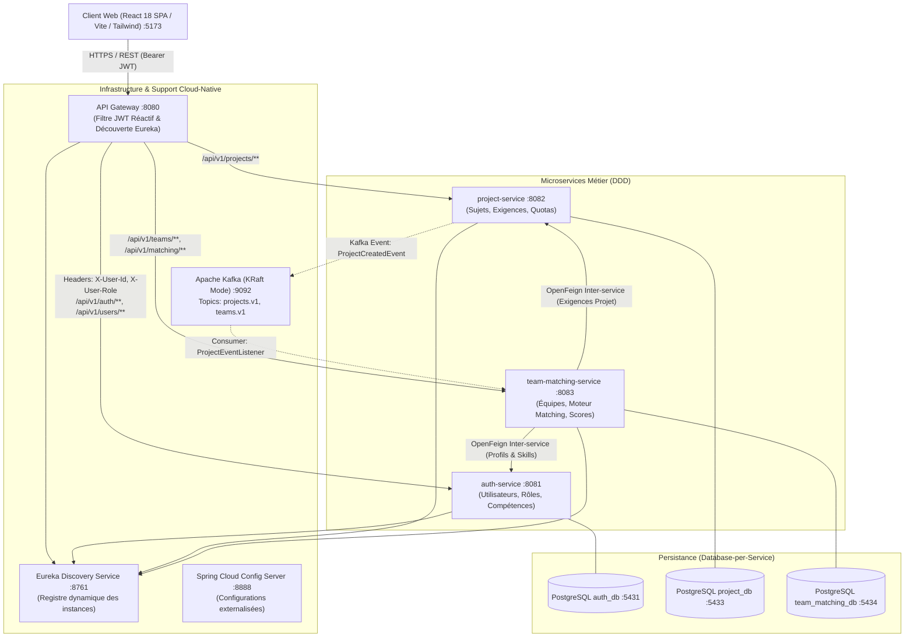
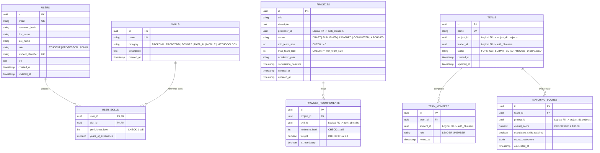
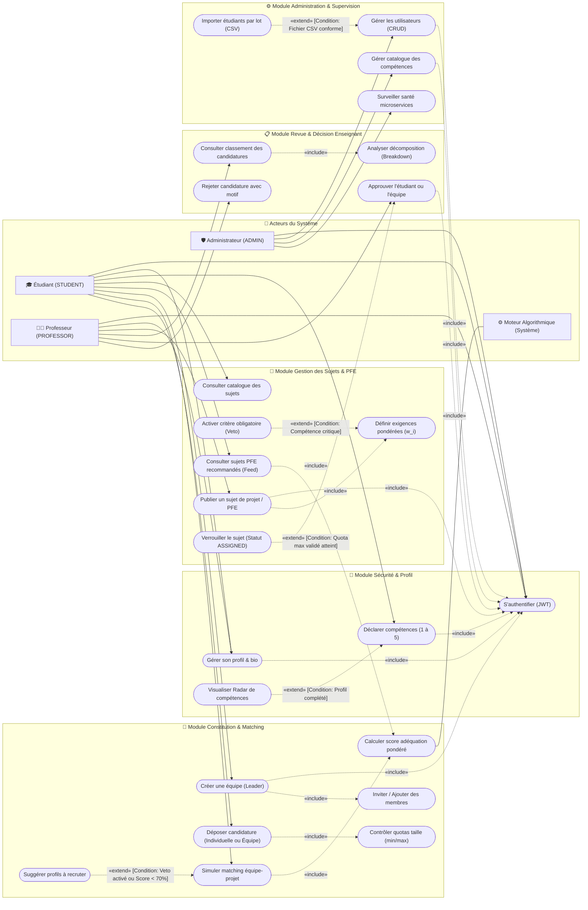
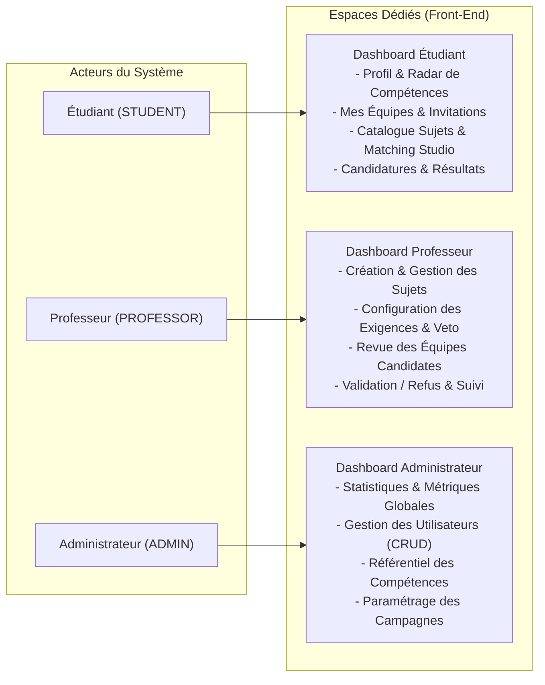
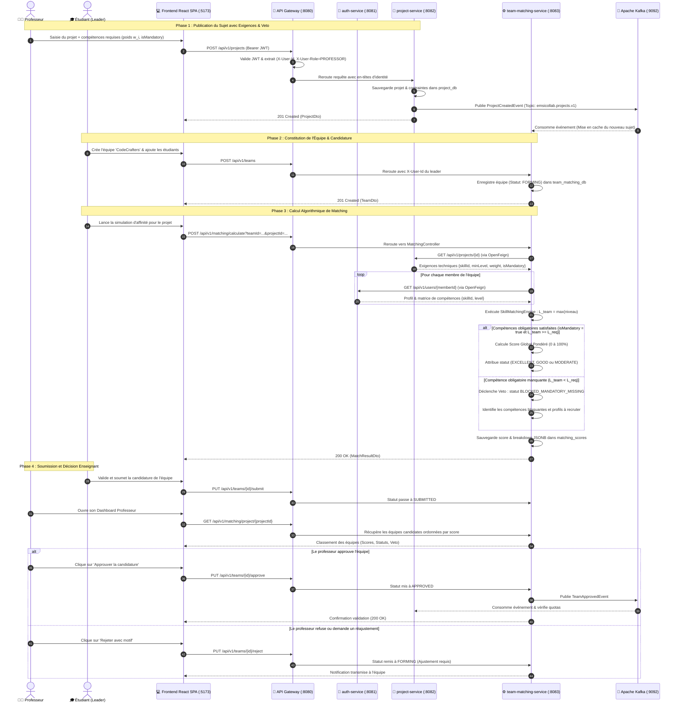
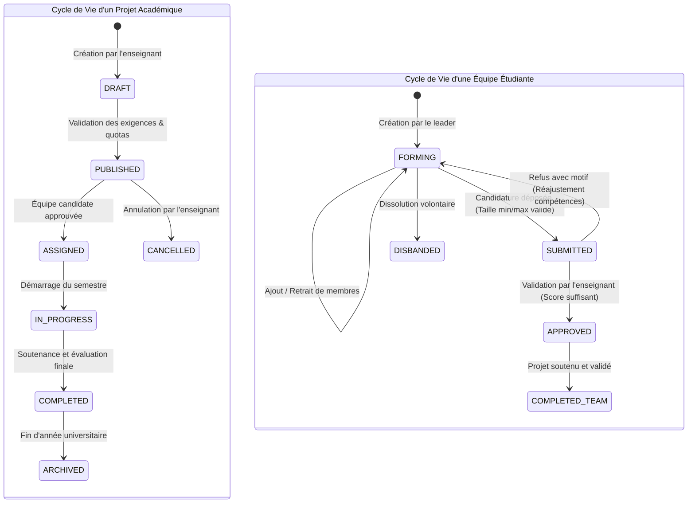
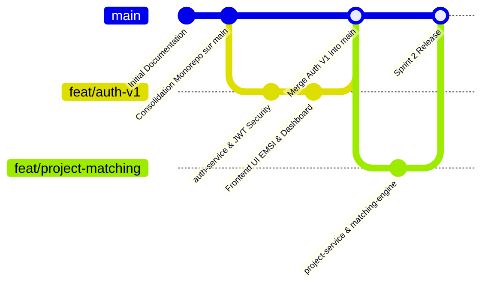
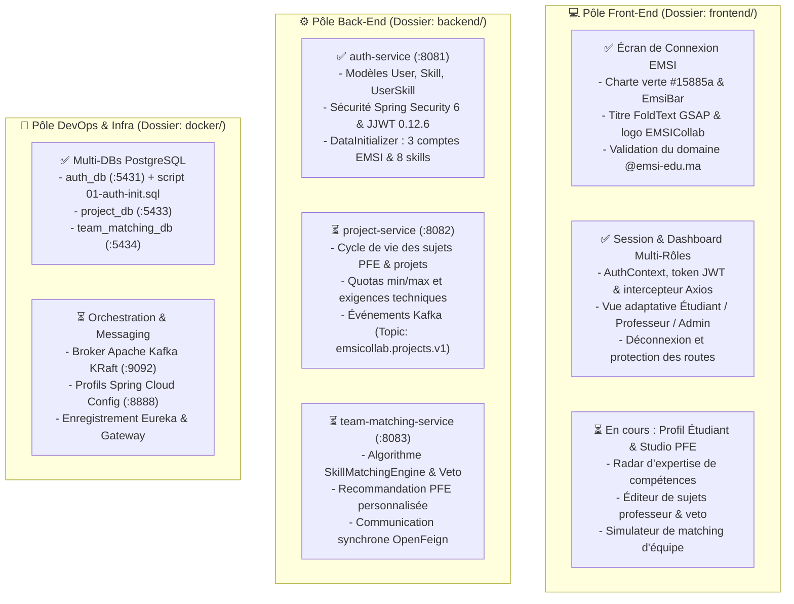

# 🎓 EMSICollab — Plateforme Microservices Intelligente de Gestion de Projets Académiques, Sujets PFE & Matching de Compétences

[](https://spring.io/projects/spring-boot)
[](https://spring.io/projects/spring-cloud)
[](https://www.oracle.com/java/)
[](https://reactjs.org/)
[](https://www.postgresql.org/)
[](https://kafka.apache.org/)
[](https://tailwindcss.com/)
[](ABOUT.md)

---

## 📑 Sommaire

1. [Vue d'Ensemble & Vision du Projet](#-1-vue-densemble--vision-du-projet)
2. [Architecture Microservices & Stack Technique](#-2-architecture-microservices--stack-technique)
3. [Entités & Modèle de Données Détaillé (ERD)](#-3-entités--modèle-de-données-détaillé-erd)
4. [Diagramme des Cas d'Utilisation UML (Use Cases)](#-4-diagramme-des-cas-dutilisation-uml-use-cases)
5. [Moteur Algorithmique de Matching & Recommandation](#-5-moteur-algorithmique-de-matching--recommandation)
6. [Spécification Complète des Dashboards par Rôle](#-6-spécification-complète-des-dashboards-par-rôle)
   - [6.1 Dashboard Étudiant (Student)](#61-dashboard-étudiant-student)
   - [6.2 Dashboard Professeur (Professor)](#62-dashboard-professeur-professor)
   - [6.3 Dashboard Administrateur (Admin)](#63-dashboard-administrateur-admin)
7. [Diagrammes de Séquence & Cycles de Vie](#-7-diagrammes-de-séquence--cycles-de-vie)
8. [Contrats d'APIs & Endpoints REST](#-8-contrats-dapis--endpoints-rest)
9. [Architecture Monorepo & Stratégie Git](#-9-architecture-monorepo--stratégie-git)
10. [Guide du Développeur & État d'Avancement des Pôles](#-10-guide-du-développeur--état-davancement-des-pôles)
11. [Installation, Démarrage Rapide & Comptes de Démonstration](#-11-installation-démarrage-rapide--comptes-de-démonstration)

---

## 🌟 1. Vue d'Ensemble & Vision du Projet

**EMSICollab** est une plateforme académique cloud-native spécialement conçue pour l'**École Marocaine des Sciences de l'Ingénieur (EMSI)**, orchestrant la gestion des **Sujets PFE (Projets de Fin d'Études)** et **Projets Académiques Complexes**, en s'appuyant sur un moteur algorithmique d'adéquation et de recommandation de compétences.

### Problématique Résolue :
Dans les cursus d'ingénierie et d'informatique :
1. **Attribution et choix des sujets PFE** : Les étudiants ont souvent du mal à identifier les sujets PFE qui correspondent précisément à leurs compétences réelles et à leurs aspirations professionnelles. De leur côté, les professeurs reçoivent des candidatures inadéquates nécessitant un tri manuel fastidieux.
2. **Constitution inefficace ou déséquilibrée des équipes** : Pour les projets menés en binôme ou en groupe, les étudiants s'associent généralement par affinité, conduisant à des équipes déséquilibrées (ex: 4 profils backend sans compétences frontend ou DevOps), sources de retards et d'échecs.

### Solution EMSICollab :
- **Profilage fin des compétences** : Chaque étudiant déclare ses compétences techniques avec un niveau d'expertise (1 à 5) et ses années d'expérience, visualisées sous forme de Radar d'expertise.
- **Publication granulaire des sujets PFE & Projets** : Les enseignants publient des sujets de projets (individuels `min=1` ou en équipe `min=2..4`) avec une description détaillée et des exigences technologiques précises (niveaux requis, pondérations $w_i$, compétences obligatoires/veto).
- **Moteur de recommandation PFE personnalisé pour chaque étudiant** : L'étudiant dispose d'un flux personnalisé de sujets PFE classés par score de compatibilité décroissant (ex: *95% Match*), avec mise en évidence des prérequis satisfaits et des compétences manquantes.
- **Moteur d'adéquation pondérée d'équipe (Skills Compatibility Engine)** : Évaluation automatique et en temps réel de l'adéquation d'une équipe avec un sujet, alertes sur les compétences manquantes et recommandations de coéquipiers.
- **Gestion du cycle de vie complet** : De la publication du PFE, la recommandation, la postulation, jusqu'à la revue et la validation par l'enseignant.

---

## 🏛️ 2. Architecture Microservices & Stack Technique

Le projet adopte les principes du **Domain-Driven Design (DDD)**, la séparation stricte **Database-per-Service**, et une architecture orientée événements (**Event-Driven Architecture**) avec Apache Kafka.

### Diagramme d'Architecture Globale



### Inventaire des Services et Composants

| Composant | Technologie | Port | Description & Responsabilité |
| :--- | :--- | :--- | :--- |
| **`gateway-service`** | Spring Cloud Gateway, Reactive | `8080` | Point d'entrée unique (Reverse Proxy), validation des tokens JWT, extraction des en-têtes d'identité (`X-User-Id`, `X-User-Role`, `X-User-Email`), gestion centralisée des règles CORS. |
| **`discovery-service`** | Spring Cloud Netflix Eureka | `8761` | Service Registry permettant l'enregistrement et la résolution dynamique des instances sans IP codées en dur. |
| **`config-service`** | Spring Cloud Config Server | `8888` | Gestionnaire centralisé des configurations et profils applicatifs (`application.yml`) pour l'ensemble des microservices. |
| **`auth-service`** | Spring Boot, Spring Security, BCrypt | `8081` | Authentification, émission des JWT, gestion des utilisateurs (Étudiant, Professeur, Admin) et référentiel global des compétences (`skills`). |
| **`project-service`** | Spring Boot, Data JPA, Kafka Producer | `8082` | Gestion du cycle de vie des projets académiques, assignation des exigences de compétences pondérées, émission d'événements Kafka lors de la création d'un sujet. |
| **`team-matching-service`** | Spring Boot, OpenFeign, Kafka Consumer | `8083` | Gestion des équipes d'étudiants, calcul matriciel d'affinité algorithmique, stockage des scores et historiques de compatibilité. |
| **`common-dtos`** | Maven Module Java | — | Bibliothèque partagée contenant les DTOs communs (`UserDto`, `ProjectDto`, `MatchResultDto`, `TeamDto`) et les schémas d'événements Kafka. |
| **`frontend`** | React 18, Vite, Tailwind CSS, Lucide | `5173` | Interface utilisateur monopage réactive proposant les 3 espaces dédiés : Étudiant, Professeur et Administrateur. |
| **`Apache Kafka`** | Confluent Kafka 7.5.3 (KRaft) | `9092` | Broker d'événements asynchrones garantissant le découplage événementiel (ex: notifications de projet, changements d'équipe). |

---

## 🗄️ 3. Entités & Modèle de Données Détaillé (ERD)

La séparation en microservices impose une séparation stricte des schémas. Aucune contrainte de clé étrangère physique SQL n'existe entre différentes bases : les relations inter-services sont modélisées par des **UUIDs logiques** résolus via les APIs REST / OpenFeign.

### Diagramme Entité-Association Global (ERD)



### Détail des Entités par Base de Données

#### A. Base `auth_db` (Port: 5431)
1. **`users`** :
   - `id` (UUID, PK) : Identifiant unique de l'utilisateur.
   - `email` (VARCHAR 180, UNIQUE) : Identifiant de connexion institutionnel.
   - `password_hash` (VARCHAR 255) : Hash chiffré par BCrypt (ex: `$2a$10$...`).
   - `first_name` & `last_name` (VARCHAR 100) : Nom et prénom de l'utilisateur.
   - `role` (VARCHAR 30) : Rôle d'accès : `STUDENT`, `PROFESSOR`, ou `ADMIN`.
   - `student_identifier` (VARCHAR 50, UNIQUE, NULLABLE) : Numéro d'étudiant / CNE pour les élèves ingénieurs.
   - `bio` (TEXT) : Présentation personnelle, intérêts techniques et parcours.
   - `created_at` & `updated_at` (TIMESTAMP) : Audit temporel.
2. **`skills`** :
   - `id` (UUID, PK) : Identifiant de la compétence.
   - `name` (VARCHAR 100, UNIQUE) : Libellé standardisé (ex: `Java / Spring Boot`, `React.js`, `Docker & Kubernetes`, `Python / ML`).
   - `category` (VARCHAR 50) : Domaine technique (`BACKEND`, `FRONTEND`, `DEVOPS`, `DATA_AI`, `MOBILE`, `METHODOLOGY`).
   - `description` (TEXT) : Définition des compétences attendues.
3. **`user_skills`** (Table de jointure porteuse d'attributs) :
   - Clé composite (`user_id`, `skill_id`).
   - `proficiency_level` (INT, 1 à 5) : Niveau déclaré (1=Débutant, 2=Élémentaire, 3=Intermédiaire, 4=Avancé, 5=Expert).
   - `years_of_experience` (NUMERIC 3,1) : Années de pratique sur la technologie.

#### B. Base `project_db` (Port: 5433)
1. **`projects`** :
   - `id` (UUID, PK) : Identifiant du sujet académique.
   - `title` (VARCHAR 255) : Titre explicite du projet.
   - `description` (TEXT) : Cahier des charges, livrables attendus et contexte pédagogique.
   - `professor_id` (UUID) : Identifiant du professeur responsable (référence logique vers `auth_db.users`).
   - `status` (VARCHAR 30) : Statut : `DRAFT` (Brouillon), `PUBLISHED` (Ouvert aux candidatures), `ASSIGNED` (Équipe validée), `COMPLETED` (Terminé).
   - `min_team_size` & `max_team_size` (INT) : Encadrement de la taille du groupe (ex: min 2, max 4).
   - `academic_year` (VARCHAR 9) : Année universitaire de référence (ex: `2026-2027`).
   - `submission_deadline` (TIMESTAMP) : Date limite de candidature des équipes.
2. **`project_requirements`** :
   - `id` (UUID, PK) : Identifiant de l'exigence.
   - `project_id` (UUID, FK) : Clé étrangère vers `projects`.
   - `skill_id` (UUID) : Compétence requise (référence logique vers `auth_db.skills`).
   - `minimum_level` (INT, 1 à 5) : Niveau minimum exigé au sein de l'équipe.
   - `weight` (NUMERIC 3,2) : Coefficient de pondération dans le calcul du score (ex: 1.0 = critique, 0.5 = secondaire).
   - `is_mandatory` (BOOLEAN) : Si `true`, l'absence de ce niveau dans l'équipe déclenche un veto bloquant.

#### C. Base `team_matching_db` (Port: 5434)
1. **`teams`** :
   - `id` (UUID, PK) : Identifiant de l'équipe.
   - `name` (VARCHAR 120, UNIQUE) : Nom d'équipe choisi par les étudiants (ex: *CodeCrafters*).
   - `project_id` (UUID, NULLABLE) : Projet ciblé ou assigné (référence logique vers `project_db.projects`).
   - `leader_id` (UUID) : Étudiant créateur et chef d'équipe (référence logique vers `auth_db.users`).
   - `status` (VARCHAR 30) : Statut : `FORMING` (En cours de constitution), `SUBMITTED` (Candidature déposée), `APPROVED` (Validée par l'enseignant), `DISBANDED` (Dissoute).
2. **`team_members`** :
   - `id` (UUID, PK) : Identifiant de l'adhésion.
   - `team_id` (UUID, FK) : Équipe concernée.
   - `student_id` (UUID) : Étudiant membre de l'équipe (référence logique vers `auth_db.users`).
   - `role` (VARCHAR 30) : Rôle au sein du groupe (`LEADER` ou `MEMBER`).
   - `joined_at` (TIMESTAMP) : Date d'intégration.
3. **`matching_scores`** :
   - `id` (UUID, PK) : Identifiant du résultat calculé.
   - `team_id` (UUID, FK) : Équipe évaluée.
   - `project_id` (UUID) : Projet évalué.
   - `overall_score` (NUMERIC 5,2) : Score global d'adéquation en pourcentage (0.00% à 100.00%).
   - `mandatory_skills_satisfied` (BOOLEAN) : `true` si tous les prérequis obligatoires sont satisfaits.
   - `score_breakdown` (JSONB) : Détail complet pour chaque compétence (niveau d'équipe max, ratio obtenu, statut bloquant).

---

## 🎯 4. Diagramme des Cas d'Utilisation UML (Use Cases)

Le diagramme ci-dessous modélise les interactions complètes entre les acteurs humains (**Étudiant**, **Professeur**, **Administrateur**), le sous-système de calcul (**Moteur Algorithmique**), ainsi que les relations de dépendance fonctionnelle standard **`«include»`** (inclusions systématiques) et **`«extend»`** (extensions conditionnelles déclenchées sous conditions spécifiques).

### Diagramme de Cas d'Utilisation Global



### Grille d'Analyse des Relations Use Case

| Cas d'Utilisation Source | Relation | Cas d'Utilisation Cible | Condition d'Extension / Déclencheur |
| :--- | :--- | :--- | :--- |
| **`UC_Skills` (Déclarer compétences)** | `«include»` | **`UC_Login`** | Un token JWT valide avec rôle `STUDENT` est obligatoire. |
| **`UC_Radar` (Visualiser Radar)** | `«extend»` | **`UC_Skills`** | Condition : Déclenché lorsque l'étudiant a renseigné au moins 3 compétences. |
| **`UC_CreateProj` (Publier sujet)** | `«include»` | **`UC_DefReq`** | Tout projet exige obligatoirement au moins une compétence pondérée ($w_i > 0$). |
| **`UC_SetVeto` (Activer veto)** | `«extend»` | **`UC_DefReq`** | Condition : L'enseignant coche l'exigence comme critique (`isMandatory = true`). |
| **`UC_SubmitTeam` (Candidater)** | `«include»` | **`UC_CheckTeamSize`**| Vérifie que l'équipe respecte : $\text{minTeamSize} \le |\text{membres}| \le \text{maxTeamSize}$ (1 pour PFE individuel). |
| **`UC_BrowsePfeRec` (Recommandations PFE)** | `«include»` | **`UC_CalcScore`** | Évalue et classe automatiquement les sujets PFE ouverts selon les compétences de l'étudiant connecté. |
| **`UC_SimMatch` (Simuler)** | `«include»` | **`UC_CalcScore`** | Exécution systématique du `SkillMatchingEngine` par le backend. |
| **`UC_RecruitHelp` (Recommandation)**| `«extend»` | **`UC_SimMatch`** | Condition : Déclenché si une compétence obligatoire manque ou si le score est insuffisant. |
| **`UC_LockProj` (Verrouiller projet)** | `«extend»` | **`UC_ValidateTeam`**| Condition : Déclenché automatiquement lorsque le nombre d'équipes approuvées atteint le quota. |
| **`UC_ImportCSV` (Import en masse)** | `«extend»` | **`UC_ManageUsers`**| Condition : Déclenché si l'administrateur téléverse un fichier CSV institutionnel. |

---

## ⚙️ 5. Moteur Algorithmique de Matching & Recommandation

Le cœur d'innovation d'EMSICollab repose sur le composant **`SkillMatchingEngine`**, capable d'opérer aussi bien à l'échelle **collective (Équipe $\leftrightarrow$ Projet)** qu'à l'échelle **individuelle (Étudiant $\leftrightarrow$ Sujets PFE)**.

### 1. Calcul du Niveau d'Équipe pour une Compétence
Pour une compétence requise $s$, le niveau disponible au sein de l'équipe est déterminé par le niveau maximal détenu par l'un des membres de l'équipe :

$$L_{team}(s) = \max_{m \in \text{Membres}} \left( \text{Niveau}(m, s) \right)$$

*Remarque : Si aucun membre de l'équipe ne possède cette compétence, $L_{team}(s) = 0$.*

### 2. Calcul du Ratio de Satisfaction
Pour chaque compétence requise $s_i$ exigeant un niveau minimum $L_{req}(s_i)$ :

$$\text{Ratio}(s_i) = \min\left(1.0, \frac{L_{team}(s_i)}{L_{req}(s_i)}\right)$$

### 3. Calcul du Score Global Pondéré
Le score global d'adéquation (exprimé en pourcentage de 0 à 100) est la moyenne pondérée par les poids $w_i$ des exigences du projet :

$$\text{Score Global} = \frac{\sum_{i=1}^{n} w_i \times \text{Ratio}(s_i)}{\sum_{i=1}^{n} w_i} \times 100$$

### 4. Règle de Veto et Classification des Candidatures

```text
┌────────────────────────────────────────────────────────────────────────┐
│                        ÉVALUATION DE COMPATIBILITÉ                     │
└───────────────────────────────────┬────────────────────────────────────┘
                                    │
                  Y a-t-il une compétence obligatoire    
                  (isMandatory = true) avec L_disponible < L_req ?
                                    │
                   ┌────────────────┴────────────────┐
                 OUI                                NON
                   │                                 │
                   ▼                                 ▼
      [BLOCKED_MANDATORY_MISSING]        Évaluation selon le Score :
      - Statut non éligible / bloqué     - Score >= 85% : [EXCELLENT] (Idéal / Fortement recommandé)
      - Liste explicite des manques      - Score >= 70% : [GOOD] (Équilibré / Recommandé)
      - Suggestion de profils à recruter - Score >= 50% : [MODERATE] (Moyen)
                                         - Score <  50% : [INSUFFICIENT] (Inadéquat)
```

### 5. Recommandation Personnalisée de Sujets PFE pour chaque Étudiant

Pour orienter un étudiant vers les sujets PFE les plus pertinents par rapport à son profil, le moteur applique l'algorithme sur l'ensemble des sujets PFE publiés (`status = 'PUBLISHED'`) :

1. **Niveau individuel de l'étudiant** :
   $$L_{student}(s) = \text{Niveau}(\text{étudiant}, s) \quad (\text{0 si non déclarée})$$

2. **Ratio de couverture individuel** :
   $$\text{Ratio}_{student}(s_i) = \min\left(1.0, \frac{L_{student}(s_i)}{L_{req}(s_i)}\right)$$

3. **Score de Match PFE** :
   $$\text{Score}_{PFE}(\text{étudiant}, \text{projet}) = \frac{\sum_{i=1}^{n} w_i \times \text{Ratio}_{student}(s_i)}{\sum_{i=1}^{n} w_i} \times 100$$

4. **Génération du Feed de Recommandations** :
   - Requête via l'endpoint Gateway : `GET /api/v1/matching/recommendations/students/{studentId}`.
   - Tri automatique de la collection par `Score_PFE` décroissant.
   - Présentation à l'étudiant des sujets avec mise en évidence des technologies maîtrisées (badges verts) et des technologies à acquérir ou bloquantes (badges ambrés/rouges).

---

## 🖥️ 6. Spécification Complète des Dashboards par Rôle

Chaque utilisateur accède à un espace personnalisé selon son rôle JWT (`STUDENT`, `PROFESSOR`, `ADMIN`).



---

### 6.1 Dashboard Étudiant (Student)

L'espace de l'étudiant est centré sur la valorisation de son profil, la découverte personnalisée de sujets PFE adaptés à ses compétences, et la formation éventuelle d'équipes.

#### Composants Clés & Fonctionnalités :
1. **Fiche Profil & Compétences Personnelles** :
   - Déclaration et mise à jour de ses compétences parmi le catalogue standardisé.
   - Pour chaque compétence : choix du niveau d'expertise (étoiles de 1 à 5) et années de pratique.
   - Visualisation sous forme de **Diagramme Radar** mettant en valeur ses forces (ex: Backend 5/5, DevOps 4/5).
   - Bio et numéro d'étudiant (`student_identifier`).

2. **Feed Intelligent de Recommandations PFE & Sujets** :
   - Flux automatisé classant tous les sujets PFE publiés par les enseignants selon le **Score d'Adéquation Individuel** de l'étudiant.
   - Badge d'affinité instantané sur chaque carte de sujet : **⭐ 95% Match**, **👍 80% Match**, etc.
   - Décomposition visuelle des exigences : technologies maîtrisées (badges verts), niveau partiel (badges jaunes), et compétences manquantes ou critères veto (badges rouges).
   - Bouton de candidature directe pour les sujets PFE individuels (`min_team_size = 1`).

3. **Espace « Mon Équipe » & Binômes** :
   - **Mode Leader** : Créer une équipe, choisir le nom, rechercher des camarades par email ou nom, envoyer des invitations, désigner les rôles (`LEADER`, `MEMBER`).
   - **Mode Membre** : Consulter son équipe active, voir les autres membres et leurs compétences combinées.
   - **Matrice des Compétences d'Équipe** : Tableau croisé récapitulant les forces du groupe et identifiant les points faibles (lacunes en UI, en déploiement, etc.).

4. **Catalogue des Projets & Matching Studio d'Équipe** :
   - Liste des projets collaboratifs avec filtres par technologie ou professeur.
   - **Simulateur de Matching en temps réel** : L'étudiant sélectionne son équipe et un projet :
     - Affichage du Score Global (% de compatibilité).
     - Badge visuel : `EXCELLENT`, `GOOD`, `MODERATE` ou `BLOCKED`.
     - Tableau détaillé compétence par compétence : Niveau de l'équipe vs Niveau exigé par le professeur, coefficient de poids, indicateur de veto.
     - **Assistant de recrutement prédictif** : Si une compétence obligatoire manque, le studio suggère le profil type à recruter pour débloquer la candidature.

5. **Suivi des Candidatures** :
   - Statut des candidatures individuelles ou d'équipe (`EN ATTENTE`, `APPROUVÉE`, `REFUSÉE`).
   - Consultation des retours ou remarques du professeur encadrant.

---

### 6.2 Dashboard Professeur (Professor)

L'espace du professeur lui permet de déposer ses sujets PFE et projets académiques, de formaliser avec précision ses attentes technologiques et de sélectionner les candidats les plus compétents de manière objective.

#### Composants Clés & Fonctionnalités :
1. **Atelier de Conception de Sujets PFE & Projets (Project Studio)** :
   - Formulaire de création : Titre du sujet, description détaillée, contexte et livrables attendus, année académique, date limite de candidature.
   - Définition du format et des quotas : Sujet PFE individuel (`min_team_size = 1, max_team_size = 1`) ou projet en groupe (`min = 2, max = 4`).
   - **Éditeur d'Exigences Techniques Avancées** :
     - Sélection des technologies souhaitées depuis le catalogue de compétences.
     - Définition du niveau minimum requis (1 à 5).
     - Définition de la pondération (ex: `1.0` pour la technologie centrale du PFE, `0.5` pour un outil d'accompagnement).
     - Bascule **Critère Obligatoire (Veto)** : activation pour bloquer les candidatures ne disposant pas du niveau minimum exigé.
   - Enregistrement en brouillon (`DRAFT`) ou publication immédiate (`PUBLISHED`).

2. **Tableau de Bord des Candidatures & Sélection** :
   - Vue tabulaire et Kanban des candidatures d'étudiants (pour les PFE) ou des équipes (pour les projets de groupe).
   - Classement automatique des candidats par **Score de Matching décroissant**.
   - Alerte visuelle immédiate sur les candidatures bloquées par veto (`BLOCKED_MANDATORY_MISSING`) avec mise en évidence des lacunes.
   - Vue détaillée du profil de l'étudiant candidat (compétences, niveau, bio) ou de la composition du binôme/groupe.

3. **Centre de Décision & Validation** :
   - Boutons d'action rapide : **Valider la candidature (`APPROVE`)** ou **Refuser (`REJECT`)**.
   - En cas d'approbation : clôture automatique ou décrémentation des places disponibles sur le sujet, et notification instantanée.
   - Export récapitulatif des attributions de sujets PFE (CSV / PDF).

---

### 6.3 Dashboard Administrateur (Admin)

L'espace administrateur assure la gouvernance de la plateforme, la gestion des référentiels, la sécurité et le monitoring des flux système.

#### Composants Clés & Fonctionnalités :
1. **Indicateurs Clés & Statistiques Générales (KPIs)** :
   - Nombre total d'étudiants inscrits, de professeurs actifs et de projets publiés.
   - Nombre d'équipes formées et pourcentage d'étudiants ayant trouvé une équipe complète.
   - Taux moyen d'adéquation des équipes (score moyen de matching).
   - Graphique de répartition des compétences les plus demandées vs les plus disponibles sur le campus.

2. **Gestion des Utilisateurs & Attribution des Rôles** :
   - Annuaire complet avec recherche textuelle et filtrage par rôle (`STUDENT`, `PROFESSOR`, `ADMIN`).
   - Création manuelle d'utilisateurs ou import massif d'étudiants via fichier CSV/Excel.
   - Modification des rôles, réinitialisation de mots de passe et désactivation de comptes.

3. **Gouvernance du Catalogue des Compétences (Taxonomie)** :
   - Ajout, modification et archivage des compétences disponibles sur la plateforme.
   - Organisation par catégories (`BACKEND`, `FRONTEND`, `DEVOPS`, `DATA_AI`, `MOBILE`, `METHODOLOGY`).
   - Normalisation des intitulés pour éviter les doublons (ex: regrouper `React` et `ReactJS`).

4. **Monitoring & Santé de l'Écosystème Microservices** :
   - État de santé des instances enregistrées sur Eureka (`UP` / `DOWN`).
   - Surveillance de l'état des 3 bases de données PostgreSQL.
   - Suivi de la connectivité du cluster Kafka et des topics actifs (`emsicollab.projects.v1`, etc.).

---

## 🔄 7. Diagrammes de Séquence & Cycles de Vie

### Diagramme de Séquence Événementiel avec Alternatives (Alt / Else)

Ce diagramme illustre le parcours de bout en bout avec gestion des cas de succès, des blocages de veto et des décisions d'arbitrage de l'enseignant.



### Diagramme d'États : Cycles de Vie Projet et Équipe



---

## 📡 8. Contrats d'APIs & Endpoints REST

Toutes les requêtes passent par l'API Gateway sur le port **`8080`**.

### 1. Service d'Authentification & Utilisateurs (`auth-service`)

| Méthode | Endpoint Gateway | Rôle Minimum | Description | Corps de Requête / Réponse Clé |
| :--- | :--- | :--- | :--- | :--- |
| `POST` | `/api/v1/auth/login` | Public | Connexion et obtention du JWT | Req: `{ email, password }`<br>Res: `{ token, user: { id, email, role, ... } }` |
| `GET` | `/api/v1/users/me` | Authentifié | Profil de l'utilisateur connecté | En-tête : `Authorization: Bearer <token>` |
| `GET` | `/api/v1/users/{id}` | Authentifié | Profil détaillé d'un utilisateur | Res: `UserDto` (avec `skills[]`) |
| `GET` | `/api/v1/users/students` | Authentifié | Liste de tous les étudiants | Res: `List<UserDto>` |
| `GET` | `/api/v1/skills` | Public / Auth | Catalogue global des compétences | Res: `List<SkillDto>` |
| `POST` | `/api/v1/skills` | `ADMIN` | Ajout d'une nouvelle compétence | Req: `{ name, category, description }` |

### 2. Service de Gestion des Projets (`project-service`)

| Méthode | Endpoint Gateway | Rôle Minimum | Description | Corps de Requête / Réponse Clé |
| :--- | :--- | :--- | :--- | :--- |
| `GET` | `/api/v1/projects` | Authentifié | Liste de tous les projets publiés | Res: `List<ProjectDto>` |
| `GET` | `/api/v1/projects/{id}` | Authentifié | Détails d'un projet et ses exigences | Res: `ProjectDto` (avec `requirements[]`) |
| `GET` | `/api/v1/projects/professor/{profId}` | `PROFESSOR`, `ADMIN` | Projets créés par un professeur | Res: `List<ProjectDto>` |
| `POST` | `/api/v1/projects` | `PROFESSOR`, `ADMIN` | Création d'un nouveau projet | Req: `ProjectDto` (titre, desc, quotas, requirements[]) |

### 3. Service d'Équipes & Matching (`team-matching-service`)

| Méthode | Endpoint Gateway | Rôle Minimum | Description | Corps de Requête / Réponse Clé |
| :--- | :--- | :--- | :--- | :--- |
| `GET` | `/api/v1/teams` | Authentifié | Liste de toutes les équipes | Res: `List<TeamDto>` |
| `GET` | `/api/v1/teams/{id}` | Authentifié | Détail d'une équipe et ses membres | Res: `TeamDto` (avec `members[]`) |
| `POST` | `/api/v1/teams` | `STUDENT` | Création d'une nouvelle équipe | Req: `{ name, projectId? }` |
| `POST` | `/api/v1/teams/{id}/members/{studentId}` | `STUDENT` | Ajout d'un étudiant dans l'équipe | Path params : `id`, `studentId` |
| `POST` | `/api/v1/matching/calculate` | Authentifié | Calcul d'affinité d'équipe | Query params: `teamId`, `projectId`<br>Res: `MatchResultDto` |
| `GET` | `/api/v1/matching/recommendations/students/{studentId}` | `STUDENT`, `PROFESSOR` | **Recommandation PFE :** Liste des sujets PFE classés par score de compatibilité pour l'étudiant | Res: `List<PfeRecommendationDto>` (project, score, mandatorySatisfied, breakdown) |
| `GET` | `/api/v1/matching/project/{projectId}` | `PROFESSOR`, `ADMIN` | Scores de toutes les équipes candidates | Res: `List<MatchingScore>` |

---

## 🌿 9. Architecture Monorepo & Stratégie Git

Pour garantir une collaboration fluide, éliminer le cloisonnement de code et faciliter l'intégration continue, le projet **EMSICollab** est structuré sous forme de **Monorepo centralisé sur la branche unique `main`**. Les anciennes branches d'équipes (`frontend`, `backend`, `devops`) ont été consolidées et supprimées afin de réunir tous les modules au sein d'une seule source de vérité.

### Structure du Repository Monorepo

```text
emsicollab/
├── frontend/                   # Application Web React 18 / Vite / Tailwind CSS
│   ├── src/
│   │   ├── api/                # Client Axios configuré, JWT & intercepteurs
│   │   ├── assets/             # Logos officiels EMSI & EMSICollab, illustrations
│   │   ├── components/         # Barre EMSI (EmsiBar), Navbar, FoldText GSAP, ProtectedRoute
│   │   ├── context/            # AuthContext (gestion session, token, login/logout)
│   │   └── pages/              # Écran de connexion (LoginPage) & Dashboard multi-rôles
│   ├── package.json            # Dépendances npm (emsicollab-frontend)
│   └── vite.config.js          # Serveur de développement Vite (:5173)
├── backend/                    # Microservices Spring Boot 3 & Maven Multi-modules (Java 21)
│   ├── pom.xml                 # POM parent multi-modules (Java 21, Spring Boot 3.3.4, JJWT)
│   └── auth-service/           # Microservice Auth, JWT, Sécurité, Profils & Compétences (:8081)
│       └── src/main/java/      # Contrôleurs REST, Modèles (User, Skill), Repositories, DataInitializer
├── docker/                     # Orchestration Infrastructure & Bases de Données
│   ├── docker-compose.yml      # 3 instances PostgreSQL isolées (auth :5431, proj :5433, team :5434)
│   └── init-sql/               # Scripts SQL d'initialisation (01-auth-init.sql)
├── ABOUT.md                    # Présentation détaillée et contexte institutionnel EMSI
└── README.md                   # Documentation maîtresse unifiée
```



### Workflow de Développement au Quotidien (Trunk-Based / Feature Branches)

Tout le travail d'équipe part désormais directement de la branche **`main`** :

1. **Cloner le repository** :
   ```bash
   git clone https://github.com/Arhrid-Hamza/SmartCollab.git emsicollab
   cd emsicollab
   ```
2. **S'assurer d'être à jour sur `main`** :
   ```bash
   git checkout main
   git pull origin main
   ```
3. **Créer une branche de fonctionnalité courte durée** :
   ```bash
   git checkout -b feat/nom-de-votre-fonctionnalite
   ```
4. **Développer, committer et pousser** :
   ```bash
   git add .
   git commit -m "feat(scope): description claire de l'ajout"
   git push -u origin feat/nom-de-votre-fonctionnalite
   ```
5. **Ouvrir une Pull Request (PR)** sur GitHub avec `main` comme cible de fusion. Après revue par les pairs, la PR est fusionnée directement dans `main`.

---

## 👥 10. Guide du Développeur & État d'Avancement des Pôles

Le développement est articulé par pôle d'expertise technique dans les dossiers respectifs du monorepo.



### Matrice RACI des Chantiers Techniques

| Pôle / Dossier | Fonctionnalité Clé | Statut | Tâche & Fichiers Clés |
| :--- | :--- | :---: | :--- |
| **`frontend/`** | **Page de Login EMSI** | ✅ Réalisé | Interface de connexion moderne avec branding vert EMSI (`#15885a`), composant `EmsiBar` avec liens officiels, animation `FoldText` GSAP et validation `@emsi-edu.ma` (`frontend/src/pages/LoginPage.jsx`). |
| **`frontend/`** | **Session & Routes Protégées** | ✅ Réalisé | Contexte global `AuthContext`, stockage token JWT, Axios client (`frontend/src/api/client.js`) et redirection sécurisée (`ProtectedRoute.jsx`). |
| **`frontend/`** | **Dashboard Adaptatif** | ✅ Réalisé | Tableau de bord avec affichage conditionnel selon le rôle (`STUDENT`, `PROFESSOR`, `ADMIN`) et déconnexion sécurisée (`frontend/src/pages/DashboardPage.jsx`). |
| **`frontend/`** | **Profil & Radar Compétences** | ⏳ Prévu | Formulaire de profil étudiant avec sliders d'expertise (1 à 5) et visualisation Radar (`ProfilePage.jsx`). |
| **`frontend/`** | **Studio PFE & Matching UI** | ⏳ Prévu | Interface professeur de publication de sujets avec veto et tableau de bord de matching pour étudiants (`ProfessorStudioPage.jsx`, `TeamsPage.jsx`). |
| **`backend/`** | **Authentification & Sécurité** | ✅ Réalisé | Endpoints `/api/v1/auth/login`, `/register`, filtres `JwtAuthFilter`, hachage BCrypt (`backend/auth-service`). |
| **`backend/`** | **Profils & Compétences** | ✅ Réalisé | CRUD compétences `/api/v1/skills`, gestion des compétences utilisateur `/api/v1/users/me` et seed automatique (`DataInitializer.java`). |
| **`backend/`** | **Gestion des Sujets PFE** | ⏳ Prévu | Microservice `project-service` pour la création, publication et cycle de vie des sujets avec contraintes de taille d'équipe. |
| **`backend/`** | **Moteur de Matching** | ⏳ Prévu | Microservice `team-matching-service` intégrant `SkillMatchingEngine`, règles de veto et flux de recommandation PFE. |
| **`docker/`** | **Bases PostgreSQL Isolées** | ✅ Réalisé | 3 conteneurs PostgreSQL indépendants (`auth_db` :5431, `project_db` :5433, `team_matching_db` :5434) avec script `01-auth-init.sql`. |
| **`docker/`** | **Messagerie Kafka KRaft** | ⏳ Prévu | Configuration et activation du broker Kafka sans ZooKeeper pour la communication événementielle. |

---

## 🚀 11. Installation, Démarrage Rapide & Comptes de Démonstration

### Prérequis Système
- **Java** : JDK 21 LTS
- **Maven** : Version 3.9+
- **Node.js** : Version 20+ et `npm`
- **Docker** : Docker Desktop / Docker Engine avec plugin Docker Compose

---

### Étape 1 : Démarrage des Bases de Données via Docker

Démarrez les conteneurs PostgreSQL indépendants depuis la racine du projet :
```bash
docker compose -f docker/docker-compose.yml up -d
```

*Vérifiez que les 3 conteneurs de persistance sont bien actifs :*
```bash
docker compose -f docker/docker-compose.yml ps
```

---

### Étape 2 : Lancement du Microservice Backend (`auth-service`)

Vous pouvez lancer le service d'authentification directement via Maven :

```bash
mvn spring-boot:run -f backend/auth-service/pom.xml
```

*Ou compiler l'ensemble des modules Maven puis exécuter le JAR :*
```bash
mvn clean package -DskipTests -f backend/pom.xml
java -jar backend/auth-service/target/auth-service-1.0.0-SNAPSHOT.jar
```

Le microservice démarre sur le port **`8081`** et se connecte automatiquement à la base `auth_db` (`localhost:5431`). Au premier démarrage, le composant `DataInitializer` injecte automatiquement le catalogue des 8 compétences clés et les comptes de test.

---

### Étape 3 : Lancement de l'Application Frontend React

Dans un second terminal :
```bash
cd frontend
npm install
npm run dev
```

L'application web est accessible sur : **[http://localhost:5173](http://localhost:5173)**.

---

### 🔑 Comptes de Démonstration Pré-configurés (`@emsi-edu.ma`)

Tous les comptes ci-dessous sont pré-initialisés dans la base `auth_db` avec leurs rôles respectifs :

| Rôle | Nom & Prénom | Email Institutionnel | Mot de Passe | Description & Droits d'Accès |
| :--- | :--- | :--- | :--- | :--- |
| 🎓 **Étudiant** | **Hamza Arhrid** | `student@emsi-edu.ma` | `Student123!` | Identifiant : `STU-2026-001`. Accès à l'espace étudiant ingénieur, radar de compétences, matching et recommandations de PFE. |
| 👨‍🏫 **Professeur** | **Karim Benali** | `prof@emsi-edu.ma` | `Prof123!` | Professeur en Génie Logiciel, responsable PFE. Accès à l'atelier de création de sujets et à la revue des candidatures. |
| 🛡️ **Administrateur** | **Admin EMSICollab** | `admin@emsi-edu.ma` | `Admin123!` | Superviseur global de la plateforme académique EMSI. Gestion des comptes utilisateurs et gouvernance des compétences. |

> 📌 **Note de Sécurité** : L'interface de connexion n'autorise que les adresses email se terminant par le domaine officiel **`@emsi-edu.ma`**.

---

> 💡 **Conseil pour l'équipe** : Le projet EMSICollab est géré en **Monorepo** sur la branche **`main`**. Référez-vous à la section [Guide du Développeur](#-10-guide-du-développeur--état-davancement-des-pôles) pour organiser vos contributions sur les dossiers respectifs (`frontend/`, `backend/`, `docker/`).
