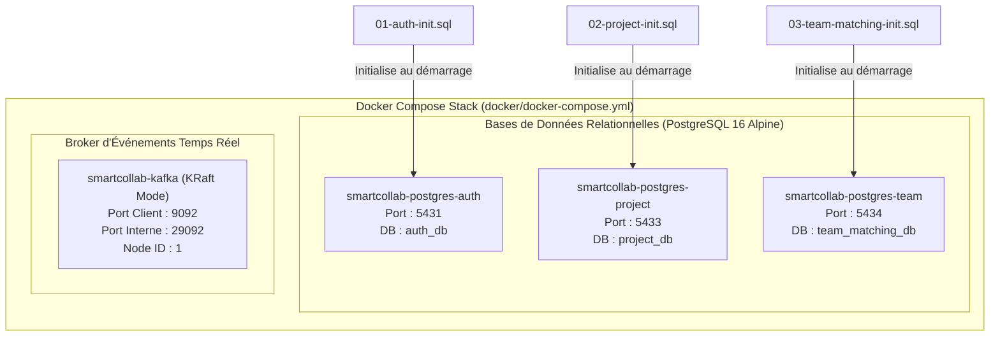

# 🐳 SmartCollab — Pôle DevOps & Infrastructure

[](https://www.docker.com/)
[](https://www.postgresql.org/)
[](https://kafka.apache.org/)
[](https://www.gnu.org/software/bash/)

Bienvenue sur la branche **`devops`** de SmartCollab ! Cette branche regroupe l'ensemble des configurations d'infrastructure conteneurisée, les scripts d'initialisation SQL des bases de données et le cluster Apache Kafka en mode KRaft.

---

## 🏛️ 1. Architecture & Topologie de l'Infrastructure

L'infrastructure applique le patron d'isolation **Database-per-Service** avec trois instances PostgreSQL indépendantes et un broker de messages Kafka moderne fonctionnant sans ZooKeeper :



---

## 🗄️ 2. Inventaire des Conteneurs & Ports Alloués

| Conteneur | Image Docker | Port Hôte : Interne | Base / Rôle | Volumes de Données |
| :--- | :--- | :--- | :--- | :--- |
| **`smartcollab-postgres-auth`** | `postgres:16-alpine` | `5431:5432` | `auth_db` (Utilisateurs, JWT, Compétences) | `postgres-auth-data` |
| **`smartcollab-postgres-project`**| `postgres:16-alpine` | `5433:5432` | `project_db` (Sujets, Exigences, Quotas) | `postgres-project-data` |
| **`smartcollab-postgres-team`** | `postgres:16-alpine` | `5434:5432` | `team_matching_db` (Équipes, Membres, Scores) | `postgres-team-data` |
| **`smartcollab-kafka`** | `confluentinc/cp-kafka:7.5.3` | `9092:9092` | Broker Apache Kafka (Mode KRaft) | `/tmp/kraft-combined-logs` |

---

## 📜 3. Scripts d'Initialisation SQL (`docker/init-sql/`)

Les scripts SQL montés dans `/docker-entrypoint-initdb.d/` préparent automatiquement les schémas et insèrent les jeux de données de démonstration au premier lancement :

1. **`01-auth-init.sql`** :
   - Extensions PostgreSQL : `uuid-ossp`, `pgcrypto`.
   - Tables : `users`, `skills`, `user_skills`.
   - Index sur rôles et compétences.
   - Jeu d'essai : 1 Administrateur, 2 Professeurs, 4 Étudiants aux profils complémentaires (avec mots de passe hashés BCrypt `Password123!`), et 8 compétences techniques clés.
2. **`02-project-init.sql`** :
   - Tables : `projects`, `project_requirements`.
   - Contraintes : `min_team_size > 0`, `max_team_size >= min_team_size`, `CHECK(minimum_level BETWEEN 1 AND 5)`.
   - Jeu d'essai : 2 sujets de projets ouverts avec contraintes d'équipes et exigences techniques obligatoires et pondérées.
3. **`03-team-matching-init.sql`** :
   - Tables : `teams`, `team_members`, `matching_scores`.
   - Colonne `score_breakdown` au format `JSONB` pour un requêtage haute performance.
   - Jeu d'essai : 2 équipes étudiantes constituées (*CodeCrafters* et *DataStorm*).

---

## 🚀 4. Guide des Commandes Docker Compose

### Démarrer toute l'infrastructure en arrière-plan :
```bash
docker compose -f docker/docker-compose.yml up -d
```

### Vérifier l'état de santé des conteneurs :
```bash
docker compose -f docker/docker-compose.yml ps
```
*Tous les conteneurs doivent afficher le statut `healthy` ou `Up`.*

### Consulter les logs en temps réel :
```bash
# Logs de l'ensemble de l'infrastructure
docker compose -f docker/docker-compose.yml logs -f

# Logs d'un conteneur spécifique (ex: Kafka)
docker compose -f docker/docker-compose.yml logs -f kafka
```

### Tester la connectivité aux bases de données :
```bash
# Connexion à auth_db
docker exec -it smartcollab-postgres-auth psql -U postgres -d auth_db -c "\dt"

# Connexion à project_db
docker exec -it smartcollab-postgres-project psql -U postgres -d project_db -c "\dt"

# Connexion à team_matching_db
docker exec -it smartcollab-postgres-team psql -U postgres -d team_matching_db -c "\dt"
```

### Réinitialiser complètement les bases de données (Reset Usine) :
```bash
docker compose -f docker/docker-compose.yml down -v
docker compose -f docker/docker-compose.yml up -d
```
*(Le flag `-v` supprime les volumes persistants pour forcer la ré-exécution des scripts `init-sql`).*

---

## 🌿 5. Règles de Contribution sur la Branche `devops`

1. **Partir de `devops`** : Mettez à jour votre branche locale avec `git pull origin devops`.
2. **Créer une Feature Branch d'infrastructure** :
   ```bash
   git checkout -b feat/infra-nom-de-fonctionnalite
   ```
3. **Tester impérativement avec `--dry-run` et en conteneur isolé** avant de valider toute modification de schéma SQL ou de configuration réseau.
4. **Ouvrir une Pull Request** vers la branche **`devops`** pour validation.
