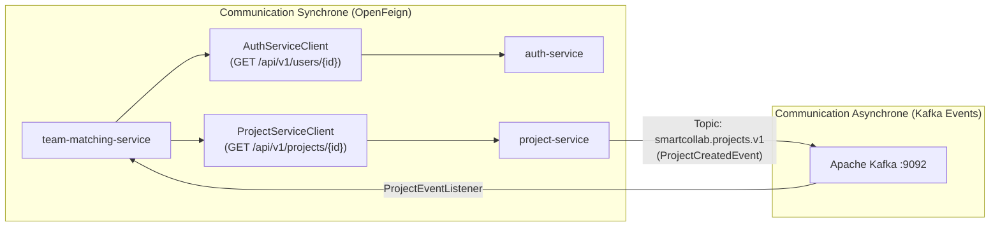

# ⚙️ SmartCollab — Pôle Back-End (Microservices Spring Boot & Cloud)

[](https://spring.io/projects/spring-boot)
[](https://spring.io/projects/spring-cloud)
[](https://www.oracle.com/java/)
[](https://www.postgresql.org/)
[](https://kafka.apache.org/)

Bienvenue sur la branche **`backend`** de SmartCollab ! Cette branche regroupe l'ensemble des microservices métier et d'infrastructure développés en **Java 21 LTS** avec **Spring Boot 3** et **Spring Cloud**.

---

## 🏛️ 1. Architecture des Modules & Microservices

Le backend applique le patron d'isolation **Database-per-Service** et les principes du **Domain-Driven Design (DDD)** :

```text
backend/
├── pom.xml                     # POM parent multi-modules (gestion des dépendances & versions)
├── common-dtos/                # Bibliothèque partagée : DTOs communs & Événements Kafka
├── discovery-service/          # Netflix Eureka Server (Registre dynamique des instances)
├── config-service/             # Spring Cloud Config Server (Configurations centralisées)
├── gateway-service/            # Spring Cloud Gateway (Filtre JWT réactif & Routage)
├── auth-service/               # Gestion des utilisateurs, rôles, JWT & catalogue des skills
├── project-service/            # Sujets de projets, exigences pondérées, quotas & Kafka producer
└── team-matching-service/      # Moteur d'adéquation pondéré, Feign clients & scores
```

### Inventaire des Services, Ports et Bases de Données :

| Service | Port | Base de Données | Rôle & Responsabilité |
| :--- | :--- | :--- | :--- |
| **`gateway-service`** | `8080` | — | Point d'entrée unique (Reverse Proxy), filtre `JwtAuthenticationFilter`, propagation d'identité (`X-User-Id`, `X-User-Role`, `X-User-Email`) et CORS. |
| **`discovery-service`**| `8761` | — | Annuaire Netflix Eureka permettant la découverte dynamique sans IPs codées en dur. |
| **`config-service`** | `8888` | — | Externalisation des profils et configurations applicatives (`application.yml`). |
| **`auth-service`** | `8081` | `auth_db` (:5431) | Authentification, hachage BCrypt, émission JWT, gestion des profils (Étudiant, Professeur, Admin) et référentiel de compétences. |
| **`project-service`** | `8082` | `project_db` (:5433) | Publication des sujets par les enseignants, quotas de groupe, exigences pondérées ($w_i$), critères de veto, émission d'événements Kafka. |
| **`team-matching-service`**| `8083` | `team_matching_db` (:5434)| Gestion des équipes étudiantes, exécution de l'algorithme d'adéquation, persistance des scores et des décompositions JSONB. |
| **`common-dtos`** | — | — | DTOs partagés (`UserDto`, `ProjectDto`, `TeamDto`, `MatchResultDto`) et événements Kafka (`ProjectCreatedEvent`). |

---

## ⚙️ 2. Moteur Algorithmique (`SkillMatchingEngine`)

Le composant central `SkillMatchingEngine` évalue l'adéquation d'une équipe avec les exigences d'un projet académique selon la formule mathématique suivante :

### 1. Niveau Maximal de l'Équipe pour une Compétence
$$L_{team}(s) = \max_{m \in \text{Membres}} \left( \text{Niveau}(m, s) \right)$$

### 2. Ratio de Satisfaction par Compétence
Pour chaque compétence requise $s_i$ avec un niveau minimum attendu $L_{req}(s_i)$ :
$$\text{Ratio}(s_i) = \min\left(1.0, \frac{L_{team}(s_i)}{L_{req}(s_i)}\right)$$

### 3. Score Global Pondéré
$$\text{Score Global} = \frac{\sum_{i=1}^{n} w_i \times \text{Ratio}(s_i)}{\sum_{i=1}^{n} w_i} \times 100$$

### 4. Règle de Veto (Compétence Obligatoire)
- Si une compétence est marquée `isMandatory = true` et que $L_{team}(s_i) < L_{req}(s_i)$ :
  - L'équipe est classée **`BLOCKED_MANDATORY_MISSING`**.
  - Une liste explicite des compétences bloquantes est renvoyée pour suggérer les profils à recruter.
- Sinon, le score détermine la classification :
  - $\ge 85\%$ : **`EXCELLENT`** (Équipe optimale)
  - $\ge 70\%$ : **`GOOD`** (Équipe équilibrée)
  - $\ge 50\%$ : **`MODERATE`** (Compétences partielles)
  - $< 50\%$ : **`INSUFFICIENT`** (Inadéquat)

---

## 📡 3. Communication Inter-Services (Synchrone & Asynchrone)



---

## 📦 4. Guide de Compilation & Démarrage

### Prérequis
- **Java** : JDK 21 LTS
- **Maven** : Version 3.9+
- **Docker** : Conteneurs des bases de données et Kafka démarrés (via la branche `devops`).

### Étape 1 : Compilation Complète du Projet
À la racine du dossier `backend/` :
```bash
mvn clean package -DskipTests
```

### Étape 2 : Ordre de Démarrage Impératif des Microservices
Démarrez les services dans l'ordre suivant (dans des terminaux distincts) :

1. **Discovery Server (Eureka)** :
   ```bash
   java -jar discovery-service/target/discovery-service-1.0.0-SNAPSHOT.jar
   ```
   *(Vérifiez la console Eureka sur : [http://localhost:8761](http://localhost:8761))*

2. **Config Server** :
   ```bash
   java -jar config-service/target/config-service-1.0.0-SNAPSHOT.jar
   ```

3. **API Gateway** :
   ```bash
   java -jar gateway-service/target/gateway-service-1.0.0-SNAPSHOT.jar
   ```

4. **Auth Service** :
   ```bash
   java -jar auth-service/target/auth-service-1.0.0-SNAPSHOT.jar
   ```

5. **Project Service** :
   ```bash
   java -jar project-service/target/project-service-1.0.0-SNAPSHOT.jar
   ```

6. **Team Matching Service** :
   ```bash
   java -jar team-matching-service/target/team-matching-service-1.0.0-SNAPSHOT.jar
   ```

---

## 🌿 5. Règles de Contribution sur la Branche `backend`

1. **Partir de `backend`** : Mettez à jour votre branche locale avec `git pull origin backend`.
2. **Créer votre Feature Branch** :
   ```bash
   git checkout -b feat/back-nom-de-votre-service
   ```
3. **Convention pour les DTOs** : Tout DTO ou événement partagé entre plusieurs microservices **doit obligatoirement être déclaré dans `backend/common-dtos`** avant d'être utilisé dans un service métier.
4. **Ouvrir une Pull Request** vers la branche **`backend`** pour validation par les pairs.
