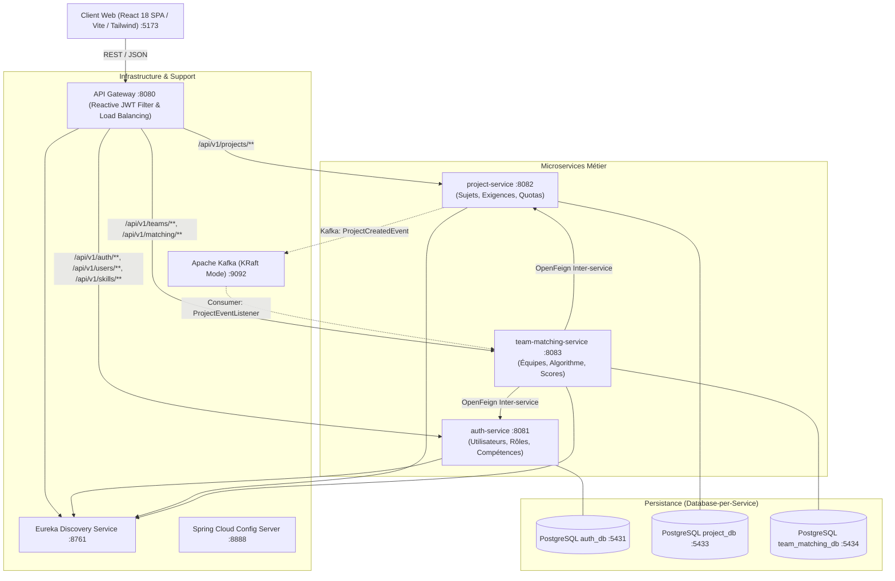
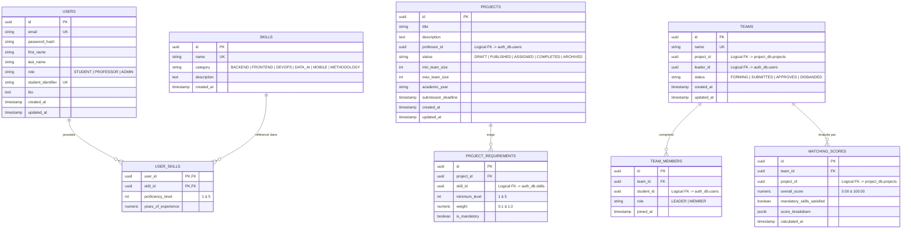
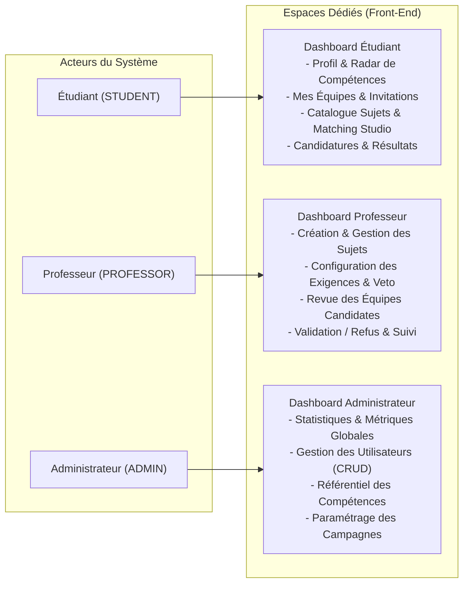
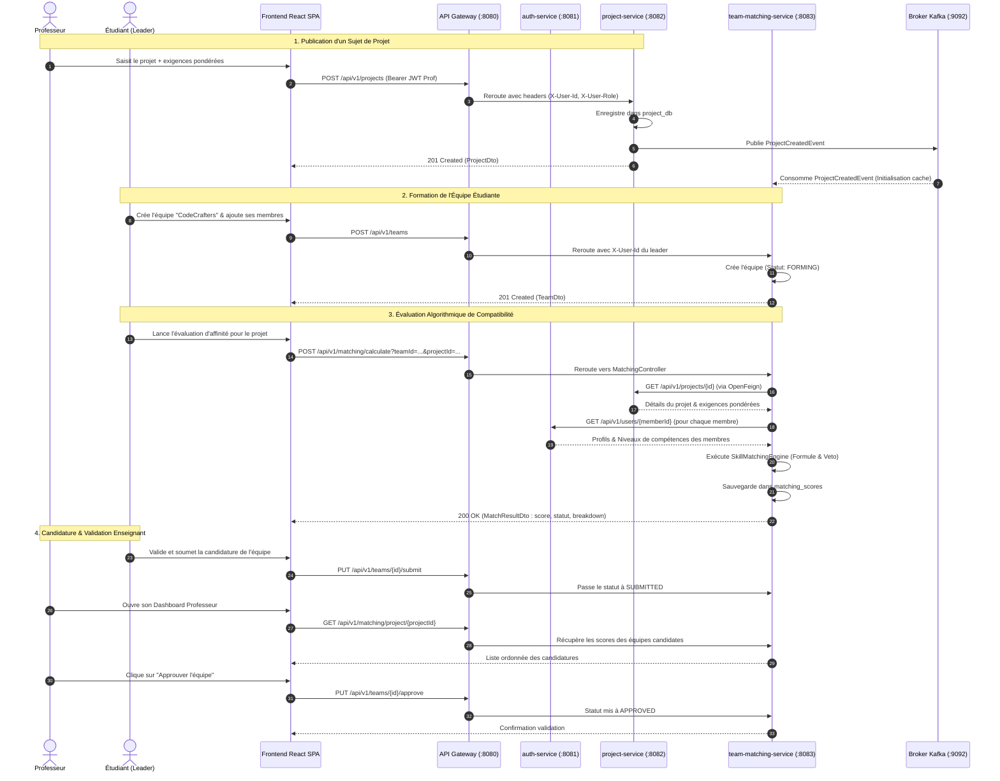
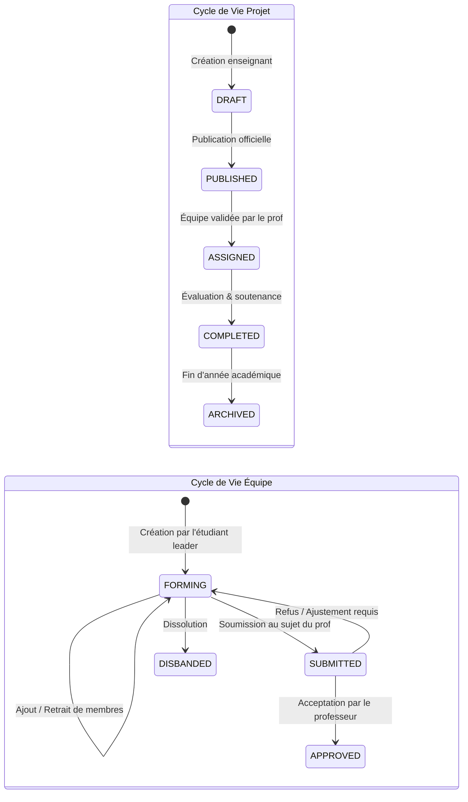
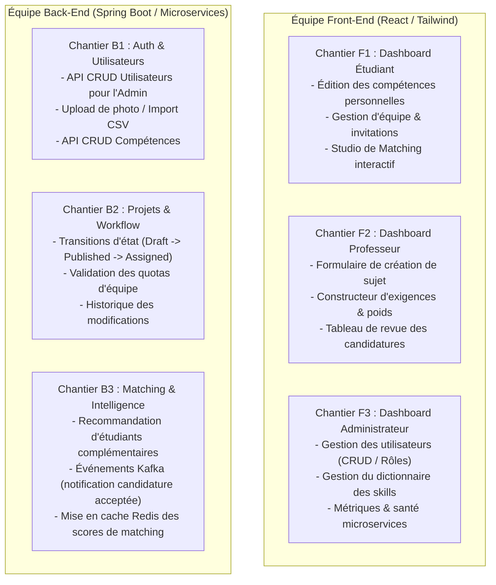

# 🎓 SmartCollab — Plateforme Microservices Intelligente de Gestion de Projets & Matching de Compétences

[](https://spring.io/projects/spring-boot)
[](https://spring.io/projects/spring-cloud)
[](https://www.oracle.com/java/)
[](https://reactjs.org/)
[](https://www.postgresql.org/)
[](https://kafka.apache.org/)
[](https://tailwindcss.com/)

---

## 📑 Sommaire

1. [Vue d'Ensemble & Vision du Projet](#-1-vue-densemble--vision-du-projet)
2. [Architecture Microservices & Stack Technique](#-2-architecture-microservices--stack-technique)
3. [Entités & Modèle de Données Détaillé (ERD)](#-3-entités--modèle-de-données-détaillé-erd)
4. [Moteur Algorithmique de Matching de Compétences](#-4-moteur-algorithmique-de-matching-de-compétences)
5. [Spécification Complète des Dashboards par Rôle](#-5-spécification-complète-des-dashboards-par-rôle)
   - [5.1 Dashboard Étudiant (Student)](#51-dashboard-étudiant-student)
   - [5.2 Dashboard Professeur (Professor)](#52-dashboard-professeur-professor)
   - [5.3 Dashboard Administrateur (Admin)](#53-dashboard-administrateur-admin)
6. [Diagrammes de Séquence & Cycles de Vie](#-6-diagrammes-de-séquence--cycles-de-vie)
7. [Contrats d'APIs & Endpoints REST](#-7-contrats-dapis--endpoints-rest)
8. [Guide du Développeur & Répartition des Tâches Collaborateurs](#-8-guide-du-développeur--répartition-des-tâches-collaborateurs)
9. [Installation, Déploiement & Comptes de Démonstration](#-9-installation-déploiement--comptes-de-démonstration)

---

## 🌟 1. Vue d'Ensemble & Vision du Projet

**SmartCollab** est une plateforme académique cloud-native conçue pour résoudre l'un des problèmes majeurs de l'enseignement supérieur : **la constitution inefficace ou déséquilibrée des équipes d'étudiants pour les projets techniques**.

### Problématique Résolue :
Dans les cursus d'ingénierie et d'informatique, les projets complexes (Microservices, IA, Full-Stack, IoT) exigent un éventail diversifié de compétences (Backend, Frontend, DevOps, Data Science). Les étudiants forment souvent leurs équipes par affinité personnelle, conduisant à des équipes homogènes (ex: 4 profils backend sans compétences frontend ou UI), provoquant des échecs de projet ou des surcharges individuelles.

### Solution SmartCollab :
- **Profilage fin des compétences** : Chaque étudiant déclare ses compétences techniques avec un niveau d'expertise (1 à 5) et son expérience.
- **Définition granulaire des besoins de projet** : Les professeurs publient des projets assortis d'exigences techniques précises (niveaux requis, pondérations, compétences obligatoires/veto).
- **Moteur d'adéquation pondérée (Skills Compatibility Engine)** : Évaluation automatique et en temps réel de l'adéquation d'une équipe avec un sujet, alertes sur les compétences manquantes et recommandations de coéquipiers.
- **Gestion du cycle de vie complet** : De la constitution d'équipe à la soumission, l'évaluation et la validation par l'enseignant.

---

## 🏛️ 2. Architecture Microservices & Stack Technique

Le projet adopte les principes du **Domain-Driven Design (DDD)**, la séparation stricte **Database-per-Service**, et une architecture orientée événements (**Event-Driven Architecture**) avec Apache Kafka.

### Diagramme d'Architecture Globale



### Inventaire des Services et Composants

| Composant | Technologie | Port | Description & Responsabilité |
| :--- | :--- | :--- | :--- |
| **`gateway-service`** | Spring Cloud Gateway, Reactive | `8080` | Point d'entrée unique (Reverse Proxy), validation des tokens JWT, extraction des en-têtes d'identité (`X-User-Id`, `X-User-Role`, `X-User-Email`), gestion centralisée des règles CORS. |
| **`discovery-service`** | Spring Cloud Netflix Eureka | `8761` | Service Registry permettant l'enregistrement et la résolution dynamique des instances sans IP codées en dur. |
| **`config-service`** | Spring Cloud Config Server | `8888` | Gestionnaire centralisé des configurations et profils applicatifs (`application.yml`) pour l'ensemble des microservices. |
| **`auth-service`** | Spring Boot, Spring Security, BCrypt | `8081` | Authentification, émission des JWT, gestion des utilisateurs (Étudiant, Professeur, Admin) et référentiel global des compétences (`skills`). |
| **`project-service`** | Spring Boot, Data JPA, Kafka Producer | `8082` | Gestion du cycle de vie des projets académiques, assignation des exigences de compétences pondérées, émission d'événements Kafka lors de la création d'un projet. |
| **`team-matching-service`** | Spring Boot, OpenFeign, Kafka Consumer | `8083` | Gestion des équipes d'étudiants, calcul matriciel d'affinité algorithmique, stockage des scores et historiques de compatibilité. |
| **`frontend`** | React 18, Vite, Tailwind CSS, Lucide | `5173` | Interface utilisateur monopage réactive proposant les 3 espaces dédiés : Étudiant, Professeur et Administrateur. |
| **`Apache Kafka`** | Confluent Kafka 7.5.3 (KRaft) | `9092` | Broker d'événements asynchrones garantissant le découplage événementiel (ex: notifications de projet, changements d'équipe). |

---

## 🗄️ 3. Entités & Modèle de Données Détaillé (ERD)

La séparation en microservices impose une séparation stricte des schémas. Aucune contrainte de clé étrangère physique SQL n'existe entre différentes bases : les relations inter-services sont modélisées par des **UUIDs logiques** résolus via les APIs REST / OpenFeign.

### Diagramme Entité-Association Global (ERD)



### Détail des Entités par Base de Données

#### A. Base `auth_db` (Port: 5431)
1. **`users`** :
   - `id` (UUID, PK) : Identifiant unique de l'utilisateur.
   - `email` (VARCHAR 180, UNIQUE) : Identifiant de connexion institutionnel.
   - `password_hash` (VARCHAR 255) : Hash chiffré par BCrypt (ex: `$2a$10$...`).
   - `first_name` & `last_name` (VARCHAR 100) : Nom et prénom de l'utilisateur.
   - `role` (VARCHAR 30) : Rôle d'accès : `STUDENT`, `PROFESSOR`, ou `ADMIN`.
   - `student_identifier` (VARCHAR 50, UNIQUE, NULLABLE) : Numéro d'étudiant / CNE pour les élèves ingénieurs.
   - `bio` (TEXT) : Présentation personnelle, intérêts techniques et parcours.
   - `created_at` & `updated_at` (TIMESTAMP) : Audit temporel.
2. **`skills`** :
   - `id` (UUID, PK) : Identifiant de la compétence.
   - `name` (VARCHAR 100, UNIQUE) : Libellé standardisé (ex: `Java / Spring Boot`, `React.js`, `Docker & Kubernetes`, `Python / ML`).
   - `category` (VARCHAR 50) : Domaine technique (`BACKEND`, `FRONTEND`, `DEVOPS`, `DATA_AI`, `MOBILE`, `METHODOLOGY`).
   - `description` (TEXT) : Définition des compétences attendues.
3. **`user_skills`** (Table de jointure porteuse d'attributs) :
   - Clé composite (`user_id`, `skill_id`).
   - `proficiency_level` (INT, 1 à 5) : Niveau déclaré (1=Débutant, 2=Élémentaire, 3=Intermédiaire, 4=Avancé, 5=Expert).
   - `years_of_experience` (NUMERIC 3,1) : Années de pratique sur la technologie.

#### B. Base `project_db` (Port: 5433)
1. **`projects`** :
   - `id` (UUID, PK) : Identifiant du sujet académique.
   - `title` (VARCHAR 255) : Titre explicite du projet.
   - `description` (TEXT) : Cahier des charges, livrables attendus et contexte pédagogique.
   - `professor_id` (UUID) : Identifiant du professeur responsable (référence logique vers `auth_db.users`).
   - `status` (VARCHAR 30) : Statut : `DRAFT` (Brouillon), `PUBLISHED` (Ouvert aux candidatures), `ASSIGNED` (Équipe validée), `COMPLETED` (Terminé).
   - `min_team_size` & `max_team_size` (INT) : Encadrement de la taille du groupe (ex: min 2, max 4).
   - `academic_year` (VARCHAR 9) : Année universitaire de référence (ex: `2026-2027`).
   - `submission_deadline` (TIMESTAMP) : Date limite de candidature des équipes.
2. **`project_requirements`** :
   - `id` (UUID, PK) : Identifiant de l'exigence.
   - `project_id` (UUID, FK) : Clé étrangère vers `projects`.
   - `skill_id` (UUID) : Compétence requise (référence logique vers `auth_db.skills`).
   - `minimum_level` (INT, 1 à 5) : Niveau minimum exigé au sein de l'équipe.
   - `weight` (NUMERIC 3,2) : Coefficient de pondération dans le calcul du score (ex: 1.0 = critique, 0.5 = secondaire).
   - `is_mandatory` (BOOLEAN) : Si `true`, l'absence de ce niveau dans l'équipe déclenche un veto bloquant.

#### C. Base `team_matching_db` (Port: 5434)
1. **`teams`** :
   - `id` (UUID, PK) : Identifiant de l'équipe.
   - `name` (VARCHAR 120, UNIQUE) : Nom d'équipe choisi par les étudiants (ex: *CodeCrafters*).
   - `project_id` (UUID, NULLABLE) : Projet ciblé ou assigné (référence logique vers `project_db.projects`).
   - `leader_id` (UUID) : Étudiant créateur et chef d'équipe (référence logique vers `auth_db.users`).
   - `status` (VARCHAR 30) : Statut : `FORMING` (En cours de constitution), `SUBMITTED` (Candidature déposée), `APPROVED` (Validée par l'enseignant), `DISBANDED` (Dissoute).
2. **`team_members`** :
   - `id` (UUID, PK) : Identifiant de l'adhésion.
   - `team_id` (UUID, FK) : Équipe concernée.
   - `student_id` (UUID) : Étudiant membre de l'équipe (référence logique vers `auth_db.users`).
   - `role` (VARCHAR 30) : Rôle au sein du groupe (`LEADER` ou `MEMBER`).
   - `joined_at` (TIMESTAMP) : Date d'intégration.
3. **`matching_scores`** :
   - `id` (UUID, PK) : Identifiant du résultat calculé.
   - `team_id` (UUID, FK) : Équipe évaluée.
   - `project_id` (UUID) : Projet évalué.
   - `overall_score` (NUMERIC 5,2) : Score global d'adéquation en pourcentage (0.00% à 100.00%).
   - `mandatory_skills_satisfied` (BOOLEAN) : `true` si tous les prérequis obligatoires sont satisfaits.
   - `score_breakdown` (JSONB) : Détail complet pour chaque compétence (niveau d'équipe max, ratio obtenu, statut bloquant).

---

## ⚙️ 4. Moteur Algorithmique de Matching de Compétences

Le cœur d'innovation de SmartCollab repose sur le composant **`SkillMatchingEngine`**.

### 1. Calcul du Niveau d'Équipe pour une Compétence
Pour une compétence requise $s$, le niveau disponible au sein de l'équipe est déterminé par le niveau maximal détenu par l'un des membres de l'équipe :

$$L_{team}(s) = \max_{m \in \text{Membres}} \left( \text{Niveau}(m, s) \right)$$

*Remarque : Si aucun membre de l'équipe ne possède cette compétence, $L_{team}(s) = 0$.*

### 2. Calcul du Ratio de Satisfaction
Pour chaque compétence requise $s_i$ exigeant un niveau minimum $L_{req}(s_i)$ :

$$\text{Ratio}(s_i) = \min\left(1.0, \frac{L_{team}(s_i)}{L_{req}(s_i)}\right)$$

### 3. Calcul du Score Global Pondéré
Le score global d'adéquation (exprimé en pourcentage de 0 à 100) est la moyenne pondérée par les poids $w_i$ des exigences du projet :

$$\text{Score Global} = \frac{\sum_{i=1}^{n} w_i \times \text{Ratio}(s_i)}{\sum_{i=1}^{n} w_i} \times 100$$

### 4. Règle de Veto et Classification des Équipes

```text
┌────────────────────────────────────────────────────────────────────────┐
│                        ÉVALUATION DE COMPATIBILITÉ                     │
└───────────────────────────────────┬────────────────────────────────────┘
                                    │
                  Y a-t-il une compétence obligatoire    
                  (isMandatory = true) avec L_team < L_req ?
                                    │
                   ┌────────────────┴────────────────┐
                 OUI                                NON
                   │                                 │
                   ▼                                 ▼
      [BLOCKED_MANDATORY_MISSING]        Évaluation selon le Score :
      - Statut non éligible              - Score >= 85% : [EXCELLENT] (Idéal)
      - Liste explicite des manques      - Score >= 70% : [GOOD] (Équilibré)
      - Suggestion de profils à recruter - Score >= 50% : [MODERATE] (Moyen)
                                         - Score <  50% : [INSUFFICIENT] (Inadéquat)
```

---

## 🖥️ 5. Spécification Complète des Dashboards par Rôle

Chaque utilisateur accède à un espace personnalisé selon son rôle JWT (`STUDENT`, `PROFESSOR`, `ADMIN`).



---

### 5.1 Dashboard Étudiant (Student)

L'espace de l'étudiant est centré sur la valorisation de son profil, la formation de son équipe et l'analyse de compatibilité avec les sujets proposés.

#### Composants Clés & Fonctionnalités :
1. **Fiche Profil & Compétences Personnelles** :
   - Déclaration et mise à jour de ses compétences parmi le catalogue standardisé.
   - Pour chaque compétence : choix du niveau d'expertise (étoiles de 1 à 5) et années de pratique.
   - Visualisation sous forme de **Diagramme Radar** mettant en valeur ses forces (ex: Backend 5/5, DevOps 4/5).
   - Bio et numéro d'étudiant (`student_identifier`).

2. **Espace « Mon Équipe »** :
   - **Mode Leader** : Créer une équipe, choisir le nom, rechercher des camarades par email ou nom, envoyer des invitations, désigner les rôles (`LEADER`, `MEMBER`).
   - **Mode Membre** : Consulter son équipe active, voir les autres membres et leurs compétences combinées.
   - **Matrice des Compétences d'Équipe** : Tableau croisé récapitulant les forces du groupe et identifiant les points faibles (lacunes en UI, en déploiement, etc.).

3. **Catalogue des Projets & Matching Studio** :
   - Liste des projets ouverts avec filtres par technologie ou professeur.
   - **Simulateur de Matching en temps réel** : L'étudiant sélectionne son équipe et un projet :
     - Affichage du Score Global (% de compatibilité).
     - Badge visuel : `EXCELLENT`, `GOOD`, `MODERATE` ou `BLOCKED`.
     - Tableau détaillé compétence par compétence : Niveau de l'équipe vs Niveau exigé par le professeur, coefficient de poids, indicateur de veto.
     - **Assistant de recrutement prédictif** : Si une compétence obligatoire manque, le studio suggère le profil type à recruter pour débloquer la candidature.

4. **Suivi des Candidatures** :
   - Statut de la candidature de l'équipe (`EN ATTENTE`, `APPROUVÉE`, `REFUSÉE`).
   - Consultation des retours ou remarques du professeur encadrant.

---

### 5.2 Dashboard Professeur (Professor)

L'espace du professeur lui permet d'encadrer les projets, de formaliser avec précision ses attentes techniques et de sélectionner les équipes les plus compétentes de manière objective.

#### Composants Clés & Fonctionnalités :
1. **Atelier de Conception de Sujets (Project Studio)** :
   - Formulaire de création de projet : Titre, description détaillée, livrables attendus, année académique, date limite de soumission.
   - Définition des quotas : Nombre d'étudiants minimum et maximum par groupe (ex: 3 à 4).
   - **Éditeur d'Exigences Techniques Avancées** :
     - Ajout de compétences depuis le catalogue.
     - Définition du niveau minimum requis (1 à 5).
     - Définition de la pondération (ex: `1.0` pour la techno principale, `0.5` pour les outils secondaires).
     - Bascule **Critère Obligatoire (Veto)** : coche pour rendre la compétence bloquante.
   - Enregistrement en brouillon (`DRAFT`) ou publication immédiate (`PUBLISHED`).

2. **Tableau de Bord des Candidatures & Équipes** :
   - Vue Kanban ou tabulaire des équipes ayant postulé à chaque projet du professeur.
   - Classement automatique des équipes par **Score de Matching décroissant**.
   - Alerte visuelle immédiate sur les équipes en veto (`BLOCKED_MANDATORY_MISSING`) avec le détail des compétences défaillantes.
   - Vue détaillée de la composition de chaque équipe (noms des étudiants, niveaux individuels et cumulés).

3. **Centre de Décision & Validation** :
   - Boutons d'action rapide : **Valider l'équipe (`APPROVE`)** ou **Refuser (`REJECT`)**.
   - En cas d'approbation : clôture automatique ou décrémentation des places disponibles sur le sujet, et notification aux étudiants.
   - Export récapitulatif de la composition finale des groupes (CSV / PDF).

---

### 5.3 Dashboard Administrateur (Admin)

L'espace administrateur assure la gouvernance de la plateforme, la gestion des référentiels, la sécurité et le monitoring des flux système.

#### Composants Clés & Fonctionnalités :
1. **Indicateurs Clés & Statistiques Générales (KPIs)** :
   - Nombre total d'étudiants inscrits, de professeurs actifs et de projets publiés.
   - Nombre d'équipes formées et pourcentage d'étudiants ayant trouvé une équipe complète.
   - Taux moyen d'adéquation des équipes (score moyen de matching).
   - Graphique de répartition des compétences les plus demandées vs les plus disponibles sur le campus.

2. **Gestion des Utilisateurs & Attribution des Rôles** :
   - Annuaire complet avec recherche textuelle et filtrage par rôle (`STUDENT`, `PROFESSOR`, `ADMIN`).
   - Création manuelle d'utilisateurs ou import massif d'étudiants via fichier CSV/Excel.
   - Modification des rôles, réinitialisation de mots de passe et désactivation de comptes.

3. **Gouvernance du Catalogue des Compétences (Taxonomie)** :
   - Ajout, modification et archivage des compétences disponibles sur la plateforme.
   - Organisation par catégories (`BACKEND`, `FRONTEND`, `DEVOPS`, `DATA_AI`, `MOBILE`, `METHODOLOGY`).
   - Normalisation des intitulés pour éviter les doublons (ex: regrouper `React` et `ReactJS`).

4. **Monitoring & Santé de l'Écosystème Microservices** :
   - État de santé des instances enregistrées sur Eureka (`UP` / `DOWN`).
   - Surveillance de l'état des 3 bases de données PostgreSQL.
   - Suivi de la connectivité du cluster Kafka et des topics actifs (`project-created-topic`, etc.).

---

## 🔄 6. Diagrammes de Séquence & Cycles de Vie

### Diagramme de Séquence : Workflow Complet (Création, Matching, Validation)



### Diagramme d'États : Cycles de Vie Projet et Équipe



---

## 📡 7. Contrats d'APIs & Endpoints REST

Toutes les requêtes passent par l'API Gateway sur le port **`8080`**.

### 1. Service d'Authentification & Utilisateurs (`auth-service`)

| Méthode | Endpoint Gateway | Rôle Minimum | Description | Corps de Requête / Réponse Clé |
| :--- | :--- | :--- | :--- | :--- |
| `POST` | `/api/v1/auth/login` | Public | Connexion et obtention du JWT | Req: `{ email, password }`<br>Res: `{ token, user: { id, email, role, ... } }` |
| `GET` | `/api/v1/users/me` | Authentifié | Profil de l'utilisateur connecté | En-tête : `Authorization: Bearer <token>` |
| `GET` | `/api/v1/users/{id}` | Authentifié | Profil détaillé d'un utilisateur | Res: `UserDto` (avec `skills[]`) |
| `GET` | `/api/v1/users/students` | Authentifié | Liste de tous les étudiants | Res: `List<UserDto>` |
| `GET` | `/api/v1/skills` | Public / Auth | Catalogue global des compétences | Res: `List<SkillDto>` |
| `POST` | `/api/v1/skills` | `ADMIN` | Ajout d'une nouvelle compétence | Req: `{ name, category, description }` |

### 2. Service de Gestion des Projets (`project-service`)

| Méthode | Endpoint Gateway | Rôle Minimum | Description | Corps de Requête / Réponse Clé |
| :--- | :--- | :--- | :--- | :--- |
| `GET` | `/api/v1/projects` | Authentifié | Liste de tous les projets publiés | Res: `List<ProjectDto>` |
| `GET` | `/api/v1/projects/{id}` | Authentifié | Détails d'un projet et ses exigences | Res: `ProjectDto` (avec `requirements[]`) |
| `GET` | `/api/v1/projects/professor/{profId}` | `PROFESSOR`, `ADMIN` | Projets créés par un professeur | Res: `List<ProjectDto>` |
| `POST` | `/api/v1/projects` | `PROFESSOR`, `ADMIN` | Création d'un nouveau projet | Req: `ProjectDto` (titre, desc, quotas, requirements[]) |

### 3. Service d'Équipes & Matching (`team-matching-service`)

| Méthode | Endpoint Gateway | Rôle Minimum | Description | Corps de Requête / Réponse Clé |
| :--- | :--- | :--- | :--- | :--- |
| `GET` | `/api/v1/teams` | Authentifié | Liste de toutes les équipes | Res: `List<TeamDto>` |
| `GET` | `/api/v1/teams/{id}` | Authentifié | Détail d'une équipe et ses membres | Res: `TeamDto` (avec `members[]`) |
| `POST` | `/api/v1/teams` | `STUDENT` | Création d'une nouvelle équipe | Req: `{ name, projectId? }` |
| `POST` | `/api/v1/teams/{id}/members/{studentId}` | `STUDENT` | Ajout d'un étudiant dans l'équipe | Path params : `id`, `studentId` |
| `POST` | `/api/v1/matching/calculate` | Authentifié | Calcul d'affinité d'équipe | Query params: `teamId`, `projectId`<br>Res: `MatchResultDto` |
| `GET` | `/api/v1/matching/project/{projectId}` | `PROFESSOR`, `ADMIN` | Scores de toutes les équipes candidates | Res: `List<MatchingScore>` |

---

## 👥 8. Guide du Développeur & Répartition des Tâches Collaborateurs

Pour permettre à chaque collaborateur de travailler en autonomie et sans conflit, les chantiers sont découpés en modules clairs :



### Matrice RACI des Tâches Techniques

| Module / Fonctionnalité | Responsable Technique | Tâche Précise à Réaliser | Fichiers Cibles Clés |
| :--- | :--- | :--- | :--- |
| **Profil & Compétences** | Dev Frontend 1 | Créer la page de profil étudiant avec sliders de niveau (1-5) et graphique Radar. | `frontend/src/pages/ProfilePage.jsx` |
| **Gestion d'Équipe UI** | Dev Frontend 1 | Interface de recherche de coéquipiers et gestion des statuts de l'équipe. | `frontend/src/pages/TeamsPage.jsx` |
| **Studio Sujets Professeur** | Dev Frontend 2 | Interface dynamique d'ajout d'exigences avec toggle `isMandatory` et sliders de poids. | `frontend/src/pages/ProfessorStudioPage.jsx` |
| **Console Administration UI** | Dev Frontend 2 | Tableaux de bord Admin avec gestion des rôles et catalogue des compétences. | `frontend/src/pages/AdminDashboardPage.jsx` |
| **Endpoints Admin Backend** | Dev Backend 1 | Ajouter les endpoints d'administration des utilisateurs et des rôles dans `auth-service`. | `UserController.java`, `SkillController.java` |
| **Workflow d'Approbation** | Dev Backend 2 | Implémenter les statuts de candidature et le verrouillage de projet dans `project-service`. | `ProjectService.java`, `Project.java` |
| **Algorithme & Suggestion** | Dev Backend 3 | Étendre `SkillMatchingEngine` pour suggérer les profils idéaux manquants à une équipe. | `SkillMatchingEngine.java`, `MatchingService.java` |
| **Événements Asynchrones** | Dev Backend 3 | Finaliser les producteurs/consommateurs Kafka pour la synchronisation inter-services. | `ProjectEventListener.java`, `TeamFormedEvent.java` |

---

## 🚀 9. Installation, Déploiement & Comptes de Démonstration

### Prérequis Système
- **Java** : JDK 21 LTS
- **Maven** : Version 3.9+
- **Node.js** : Version 20+ et `npm`
- **Docker** : Docker Desktop / Docker Engine avec plugin Docker Compose

---

### Étape 1 : Démarrage des Bases de Données & Kafka via Docker
Lancez les conteneurs PostgreSQL indépendants et le broker Kafka :
```bash
docker compose -f docker/docker-compose.yml up -d
```
*Vérifiez que tous les conteneurs sont `healthy` :*
```bash
docker compose -f docker/docker-compose.yml ps
```

---

### Étape 2 : Compilation du Backend
Compilez l'ensemble des modules Maven à la racine du projet :
```bash
mvn clean package -DskipTests -f backend/pom.xml
```

---

### Étape 3 : Démarrage des Microservices (Ordre Recommandé)
Démarrez les services dans des terminaux distincts (ou via script d'automatisation) :

1. **Discovery Server (Eureka)** :
   ```bash
   java -jar backend/discovery-service/target/discovery-service-1.0.0-SNAPSHOT.jar
   ```
   *(Interface Eureka accessible sur : [http://localhost:8761](http://localhost:8761))*

2. **Config Server** :
   ```bash
   java -jar backend/config-service/target/config-service-1.0.0-SNAPSHOT.jar
   ```

3. **API Gateway** :
   ```bash
   java -jar backend/gateway-service/target/gateway-service-1.0.0-SNAPSHOT.jar
   ```

4. **Auth Service** :
   ```bash
   java -jar backend/auth-service/target/auth-service-1.0.0-SNAPSHOT.jar
   ```

5. **Project Service** :
   ```bash
   java -jar backend/project-service/target/project-service-1.0.0-SNAPSHOT.jar
   ```

6. **Team Matching Service** :
   ```bash
   java -jar backend/team-matching-service/target/team-matching-service-1.0.0-SNAPSHOT.jar
   ```

---

### Étape 4 : Lancement de l'Application Frontend React
Dans un nouveau terminal :
```bash
cd frontend
npm install
npm run dev
```
Accédez à l'application web sur **[http://localhost:5173](http://localhost:5173)**.

---

### 🔑 Comptes de Test Pré-configurés

Tous les comptes ci-dessous sont pré-insérés en base avec le mot de passe unique : **`Password123!`**

| Utilisateur | Email | Rôle | Spécialité / Rôle Métier |
| :--- | :--- | :--- | :--- |
| **System Admin** | `admin@smartcollab.edu` | `ADMIN` | Administrateur global de la plateforme académique |
| **Dr. Mehdi Alami** | `prof.alami@smartcollab.edu` | `PROFESSOR` | Professeur en Génie Logiciel & Architectures Cloud |
| **Dr. Sara Bennani** | `prof.bennani@smartcollab.edu` | `PROFESSOR` | Professeure en Intelligence Artificielle & Big Data |
| **Yassine Benali** | `yassine.benali@smartcollab.edu` | `STUDENT` | Étudiant Leader : Backend Java / Spring Boot (5/5), Kafka, Postgres |
| **Fatima Zahra Mansouri**| `fatima.mansouri@smartcollab.edu`| `STUDENT` | Étudiante : DevOps, Docker & Kubernetes (5/5), Java |
| **Omar Tazi** | `omar.tazi@smartcollab.edu` | `STUDENT` | Étudiant : Data Science, Python & Machine Learning (5/5), Kafka |
| **Nour El Houda Idrissi**| `nour.houda@smartcollab.edu` | `STUDENT` | Étudiante : Frontend UI/UX, React.js (5/5), Tailwind |

---

> 💡 **Conseil pour l'équipe** : Consultez régulièrement la section [Guide du Développeur](#-8-guide-du-développeur--répartition-des-tâches-collaborateurs) pour synchroniser vos développements et enrichir les DTOs communs dans `backend/common-dtos` avant d'implémenter de nouveaux endpoints inter-services.
