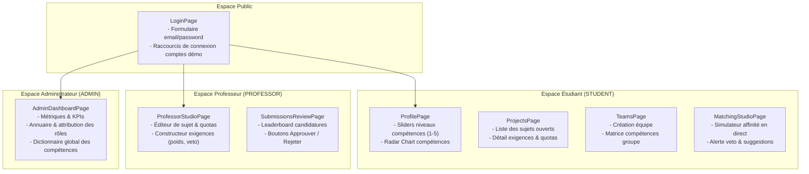

# 💻 SmartCollab — Pôle Front-End (React 18 SPA)

[](https://reactjs.org/)
[](https://vitejs.dev/)
[](https://tailwindcss.com/)
[](https://lucide.dev/)

Bienvenue sur la branche **`frontend`** de SmartCollab ! Cette branche est exclusivement dédiée au développement de l'application cliente Web monopage (SPA) intégrant les interfaces interactives pour les **Étudiants**, **Professeurs** et **Administrateurs**.

---

## 🏛️ 1. Architecture du Code Front-End

Le projet est structuré selon les standards modernes React avec Vite et Tailwind CSS :

```text
frontend/
├── public/                 # Assets statiques publics (favicon, logos)
├── src/
│   ├── api/
│   │   └── client.js       # Client Axios configuré, intercepteurs JWT & Gateway Base URL
│   ├── components/         # Composants réutilisables d'UI
│   │   ├── Navbar.jsx      # Barre de navigation responsive avec affichage du profil & rôle
│   │   ├── RadarChart.jsx  # Graphique Radar de visualisation des compétences
│   │   ├── ProtectedRoute.jsx # Garde de route par authentification et rôle JWT
│   │   └── Modal.jsx       # Boîtes de dialogue interactives
│   ├── context/
│   │   └── AuthContext.jsx # État global d'authentification (user, token, login, logout)
│   ├── pages/              # Écrans et Tableaux de bord
│   │   ├── LoginPage.jsx               # Authentification & sélection rapide des comptes démo
│   │   ├── ProfilePage.jsx             # Profil étudiant, sliders 1-5 & radar de compétences
│   │   ├── ProjectsPage.jsx            # Catalogue des sujets publiés, filtres et recherche
│   │   ├── TeamsPage.jsx               # Gestion de mon équipe, recherche et invitations
│   │   ├── MatchingStudioPage.jsx      # Studio de matching interactif, scores, veto & breakdown
│   │   ├── ProfessorStudioPage.jsx     # Création de sujets, constructeur d'exigences & veto
│   │   ├── SubmissionsReviewPage.jsx   # Revue des candidatures par le professeur & validation
│   │   └── AdminDashboardPage.jsx      # Console admin : KPIs, CRUD utilisateurs & skills
│   ├── App.jsx             # Configuration des routes (React Router 6)
│   ├── index.css           # Directives Tailwind CSS & styles globaux
│   └── main.jsx            # Point d'entrée React DOM
├── index.html              # Template HTML principal
├── package.json            # Dépendances et scripts npm
├── tailwind.config.js      # Thème et configuration Tailwind
└── vite.config.js          # Configuration du serveur de dev Vite
```

---

## 🎨 2. Spécification des Écrans à Développer



### 1. Espace Étudiant (`STUDENT`)
- **`ProfilePage.jsx`** : Formulaire interactif permettant à l'étudiant de noter son niveau d'expertise (étoiles ou sliders de 1 à 5) pour chaque technologie et d'observer son graphe radar se dessiner en temps réel.
- **`TeamsPage.jsx`** : Vue de l'équipe active, bouton de création pour le leader, barre de recherche de coéquipiers par nom/email, et matrice croisée affichant les points forts du groupe.
- **`MatchingStudioPage.jsx`** : L'étudiant sélectionne son équipe et un projet :
  - Calcul dynamique du score global ($0$ à $100\%$).
  - Badge de statut : `EXCELLENT` ($\ge 85\%$), `GOOD` ($\ge 70\%$), `MODERATE` ($\ge 50\%$) ou `BLOCKED_MANDATORY_MISSING`.
  - Tableau d'adéquation détaillée : niveau équipe vs niveau requis par l'enseignant.
  - Alerte explicite si une compétence obligatoire manque avec proposition de recrutement.

### 2. Espace Professeur (`PROFESSOR`)
- **`ProfessorStudioPage.jsx`** : Formulaire de publication de sujet avec ajout dynamique de compétences exigées, réglage des coefficients de poids ($w_i$), et toggle switch pour activer le critère obligatoire (*Veto*).
- **`SubmissionsReviewPage.jsx`** : Tableau de bord classant les équipes candidates par ordre de score décroissant, avec accès au breakdown complet et boutons d'action **Approuver (`APPROVE`)** ou **Refuser (`REJECT`)**.

### 3. Espace Administrateur (`ADMIN`)
- **`AdminDashboardPage.jsx`** : Statistiques globales (KPIs), gestion des utilisateurs (changement de rôles, activation/désactivation), et catalogue central des compétences avec catégorisation (`BACKEND`, `FRONTEND`, `DEVOPS`, `DATA_AI`, `MOBILE`).

---

## 🔌 3. Intégration API & Communication Backend

Toutes les requêtes HTTP passent par le point d'entrée unique **Spring Cloud Gateway** sur le port `8080`.

### Configuration du Client API (`src/api/client.js`) :
```javascript
import axios from 'axios';

const api = axios.create({
  baseURL: 'http://localhost:8080/api/v1',
  headers: {
    'Content-Type': 'application/json',
  },
});

// Injection automatique du token JWT dans l'en-tête Authorization
api.interceptors.request.use((config) => {
  const token = localStorage.getItem('smartcollab_token');
  if (token) {
    config.headers.Authorization = `Bearer ${token}`;
  }
  return config;
});

export default api;
```

### Endpoints REST Consommés :
| Action | Méthode | Endpoint | Rôle Requis |
| :--- | :--- | :--- | :--- |
| Connexion | `POST` | `/api/v1/auth/login` | Public |
| Profil courant | `GET` | `/api/v1/users/me` | Authentifié |
| Liste des étudiants | `GET` | `/api/v1/users/students` | Authentifié |
| Catalogue des compétences | `GET` | `/api/v1/skills` | Authentifié |
| Projets publiés | `GET` | `/api/v1/projects` | Authentifié |
| Publier un sujet | `POST` | `/api/v1/projects` | `PROFESSOR`, `ADMIN` |
| Liste des équipes | `GET` | `/api/v1/teams` | Authentifié |
| Créer une équipe | `POST` | `/api/v1/teams` | `STUDENT` |
| Ajouter un membre | `POST` | `/api/v1/teams/{id}/members/{studentId}` | `STUDENT` |
| Calculer le matching | `POST` | `/api/v1/matching/calculate?teamId=...&projectId=...` | Authentifié |
| Candidatures d'un projet | `GET` | `/api/v1/matching/project/{projectId}` | `PROFESSOR` |

---

## 🚀 4. Guide de Démarrage Rapide

### Prérequis
- **Node.js** : Version 20.x ou supérieure
- **npm** : Version 10.x ou supérieure

### Installation & Lancement
```bash
# 1. Se placer dans le dossier frontend
cd frontend

# 2. Installer les dépendances
npm install

# 3. Lancer le serveur de développement local
npm run dev
```

L'application est disponible immédiatement sur : **[http://localhost:5173](http://localhost:5173)**.

### Build de Production
```bash
npm run build
```
Les fichiers statiques optimisés sont générés dans le dossier `frontend/dist/`.

---

## 🌿 5. Règles de Contribution sur la Branche `frontend`

1. **Partir de `frontend`** : Vérifiez que vous êtes à jour avec `git pull origin frontend`.
2. **Créer votre Feature Branch** :
   ```bash
   git checkout -b feat/front-nom-de-fonctionnalite
   ```
3. **Committer avec des messages explicites** :
   ```bash
   git commit -m "feat(ui): add radar chart component for student skills"
   ```
4. **Ouvrir une Pull Request** vers la branche **`frontend`** pour revue de code.
