# 📘 EMSICollab — Cadre Général, Méthodologie Agile & Conception UML du Projet

> **Projet de Fin d'Études / Projet Académique d'Ingénierie**  
> **Institution :** École Marocaine des Sciences de l'Ingénieur (EMSI)  
> **Auteurs :** Hamza ARHRID & Issam BOUFFA  
> **Plateforme :** Plateforme Microservices Intelligente de Gestion de Projets, Matching de Compétences & Collaboration

---

## 📑 Sommaire Général

- [I) Cadre Général & Méthodologie](#i-cadre-général--méthodologie)
  - [1. Analyse de l'Existant](#1-analyse-de-lexistant)
    - [1.1 Étude Comparative (Benchmarking des Solutions Actuelles)](#11-étude-comparative-benchmarking-des-solutions-actuelles)
    - [1.2 Synthèse des Limites des Solutions Existantes](#12-synthèse-des-limites-des-solutions-existantes)
    - [1.3 Valeurs Ajoutées d'EMSICollab](#13-valeurs-ajoutées-demsicollab)
  - [2. Méthodologie de Gestion de Projet](#2-méthodologie-de-gestion-de-projet)
    - [2.1 Approche Agile (Scrum)](#21-approche-agile-scrum)
    - [2.2 Rôles, Artefacts et Cérémonies Scrum](#22-rôles-artefacts-et-cérémonies-scrum)
    - [2.3 Signification de « A1 - 2 Agilité »](#23-signification-de--a1---2-agilité-)
    - [2.4 Analyse Comparative : Scrum vs Kanban & Choix de Scrumban](#24-analyse-comparative--scrum-vs-kanban--choix-de-scrumban)
  - [3. Planning Prévisionnel & Diagramme de Gantt](#3-planning-prévisionnel--diagramme-de-gantt)
    - [3.1 Découpage des Sprints et Jalons](#31-découpage-des-sprints-et-jalons)
    - [3.2 Diagramme de Gantt du Projet](#32-diagramme-de-gantt-du-projet)
- [II) Analyse et Conception du Projet (Modélisation UML)](#ii-analyse-et-conception-du-projet-modélisation-uml)
  - [1. Diagramme des Cas d'Utilisation (Use Case Diagram)](#1-diagramme-des-cas-dutilisation-use-case-diagram)
    - [1.1 Identification des Acteurs](#11-identification-des-acteurs)
    - [1.2 Diagramme Global Synthétique des Cas d'Utilisation](#12-diagramme-global-synthétique-des-cas-dutilisation)
    - [1.3 Décomposition Modulaire des Cas d'Utilisation (Diagrammes Détaillés par Package)](#13-décomposition-modulaire-des-cas-dutilisation-diagrammes-détaillés-par-package)
      - [1.3.1 Module 1 : Sécurité, Authentification & Profils](#131-module-1--sécurité-authentification--profils)
      - [1.3.2 Module 2 : Gestion des Sujets & Cahier des Charges PDF](#132-module-2--gestion-des-sujets--cahier-des-charges-pdf)
      - [1.3.3 Module 3 : Constitution d'Équipe & Moteur de Matching Algorithmique](#133-module-3--constitution-déquipe--moteur-de-matching-algorithmique)
      - [1.3.4 Module 4 : Suivi d'Avancement, Roadmap Checkboxes & Réunions Meet](#134-module-4--suivi-davancement-roadmap-checkboxes--réunions-meet)
      - [1.3.5 Module 5 : Communication & Collaboration Temps Réel](#135-module-5--communication--collaboration-temps-réel)
      - [1.3.6 Module 6 : Administration & Gouvernance Système](#136-module-6--administration--gouvernance-système)
    - [1.4 Description Détaillée des Cas d'Utilisation Majeurs](#14-description-détaillée-des-cas-dutilisation-majeurs)
  - [2. Diagrammes de Séquence Système (Sequence Diagrams)](#2-diagrammes-de-séquence-système-sequence-diagrams)
    - [2.1 Scénario 1 : Authentification, Profilage & Radar de Compétences](#21-scénario-1--authentification-profilage--radar-de-compétences)
    - [2.2 Scénario 2 : Publication de Sujet avec Exigences Pondérées & Cahier des Charges PDF](#22-scénario-2--publication-de-sujet-avec-exigences-pondérées--cahier-des-charges-pdf)
    - [2.3 Scénario 3 : Constitution d'Équipe & Simulation de Matching avec Règle de Veto](#23-scénario-3--constitution-déquipe--simulation-de-matching-avec-règle-de-veto)
    - [2.4 Scénario 4 : Collaboration en Chatroom de Projet (Icône Carte Projet)](#24-scénario-4--collaboration-en-chatroom-de-projet-icône-carte-projet)
    - [2.5 Scénario 5 : Suivi d'Avancement par Cases à Cocher (Roadmap Checkboxes)](#25-scénario-5--suivi-davancement-par-cases-à-cocher-roadmap-checkboxes)
    - [2.6 Scénario 6 : Planification & Visioconférence Google Meet](#26-scénario-6--planification--visioconférence-google-meet)
  - [3. Diagramme de Classes du Domaine (Class Diagram)](#3-diagramme-de-classes-du-domaine-class-diagram)
    - [3.1 Vue Statique Globale du Domaine Métier](#31-vue-statique-globale-du-domaine-métier)
    - [3.2 Décomposition Modulaire du Diagramme de Classes par Microservice (Bounded Context)](#32-décomposition-modulaire-du-diagramme-de-classes-par-microservice-bounded-context)
      - [3.2.1 Service d'Authentification & Compétences (auth-service)](#321-service-dauthentification--compétences-auth-service)
      - [3.2.2 Service de Gestion des Projets, CDC PDF & Jalons (project-service)](#322-service-de-gestion-des-projets-cdc-pdf--jalons-project-service)
      - [3.2.3 Service d'Équipes & Matching Algorithmique (team-matching-service)](#323-service-déquipes--matching-algorithmique-team-matching-service)
      - [3.2.4 Service de Collaboration & Messagerie Temps Réel (chat-service)](#324-service-de-collaboration--messagerie-temps-réel-chat-service)
    - [3.3 Dictionnaire des Classes et Responsabilités](#33-dictionnaire-des-classes-et-responsabilités)

---

# I) Cadre Général & Méthodologie

## 1. Analyse de l'Existant

### 1.1 Étude Comparative (Benchmarking des Solutions Actuelles)

Dans le paysage contemporain des outils collaboratifs, de gestion de projet et de visioconférence, plusieurs solutions s'imposent dans les milieux industriels et académiques. Afin d'évaluer la pertinence de développer une plateforme dédiée, nous avons conduit un benchmarking rigoureux sur six solutions représentatives :
1. **Trello (Atlassian)** : Outil de gestion visuelle basé sur la méthode Kanban grand public.
2. **Jira Software (Atlassian)** : Solution d'entreprise taillée pour le suivi de tickets et les méthodologies agiles avancées.
3. **GitHub Projects** : Outils de suivi orientés code source et gestion du cycle de développement logiciel (ALM).
4. **Google Classroom** : Plateforme institutionnelle de distribution de devoirs et supports de cours magistraux.
5. **Zoom Video Communications** : Outil dédié de visioconférence et réunions virtuelles d'entreprise.
6. **EMSICollab (Notre Solution)** : Plateforme intégrée microservices dédiée aux projets académiques, matching de compétences et espaces collaboratifs temps réel.

| Critère d'Évaluation | Trello | Jira Software | GitHub Projects | Google Classroom | Zoom Video | **EMSICollab (Notre Solution)** |
| :--- | :---: | :---: | :---: | :---: | :---: | :---: |
| **Modèle Métier Académique (PFE / Binômes)** | ❌ Non | ❌ Non | ❌ Non | ⚠️ Partiel (Devoirs/Notes) | ❌ Non | ✅ **Natif (Sujets, PFE, Quotas, Tuteurs)** |
| **Profilage & Radar des Compétences** | ❌ Non | ❌ Non | ❌ Non | ❌ Non | ❌ Non | ✅ **Natif (Niveaux 1 à 5, Radar Chart)** |
| **Algorithme de Matching Équipe-Sujet** | ❌ Non | ❌ Non | ❌ Non | ❌ Non | ❌ Non | ✅ **Natif (Score pondéré $w_i$, Veto bloquant)** |
| **Flux de Recommandation PFE Personnalisé** | ❌ Non | ❌ Non | ❌ Non | ❌ Non | ❌ Non | ✅ **Natif (Feed trié par Score d'affinité)** |
| **Aide au Recrutement Prédictif de Profils** | ❌ Non | ❌ Non | ❌ Non | ❌ Non | ❌ Non | ✅ **Natif (Suggestion des profils manquants)** |
| **Attachement & Visualisation CDC PDF** | ⚠️ Pièce jointe basique | ⚠️ Pièce jointe basique | ⚠️ Dépôt Git | ⚠️ Fichier Google Drive | ❌ Partage d'écran temporaire | ✅ **Encart dédié avec visionneuse & versioning** |
| **Roadmap Interactive à Cases à Cocher** | ⚠️ Checklist statique | ⚠️ Sous-tâches rigides | ⚠️ Checkboxes Markdown | ⚠️ Date limite sans roadmap | ❌ Inexistant | ✅ **Jalons ordonnés, validation dynamique & jauge %** |
| **Chatroom Dédiée Projet (Icône sur carte)** | ❌ (Commentaires) | ❌ (Commentaires) | ❌ (Discussions Git) | ⚠️ Flux de classe général | ⚠️ Zoom Team Chat (non relié au projet) | ✅ **Chatroom temps réel intégrée Prof-Équipe** |
| **Messagerie Privée 1-à-1** | ❌ Non | ❌ Non | ❌ Non | ⚠️ Envoi d'email Gmail | ⚠️ Chat interne Zoom | ✅ **Chat instantané confidentiel 1-à-1** |
| **Planification Réunions & Visioconférence** | ⚠️ Plugin tiers payant | ⚠️ Plugin tiers payant | ❌ Non | ⚠️ Lien Meet général de classe | ✅ Cœur de métier (Visio HD seule) | ✅ **Lien Google Meet à date/heure précises intégré** |
| **Facilité de Prise en Main Étudiante** | ⭐⭐⭐⭐⭐ (Très simple) | ⭐⭐ (Très complexe) | ⭐⭐⭐ (Moyenne) | ⭐⭐⭐⭐ (Simple) | ⭐⭐⭐⭐⭐ (Très simple) | ⭐⭐⭐⭐⭐ **(Ergonomique & Dédié EMSI)** |
| **Coût de Licence pour l'Établissement** | Freemium limité | Coûteux par utilisateur | Gratuit étudiants / Payant équipes | Google Workspace for Edu | Payant par licence hôte | **Open-source & Cloud-Native souverain** |

---

### 1.2 Synthèse des Limites des Solutions Existantes

L'étude comparative met en lumière des carences structurelles majeures empêchant les outils du marché de répondre efficacement aux problématiques de gestion de projets d'ingénierie :

1. **Absence de modélisation du profil technique de l'étudiant** :
   - Aucun des outils généralistes (Trello, Jira, GitHub) ne permet de renseigner un profil de compétences structuré avec échelle de maîtrise (1 à 5), années d'expérience et restitution sous forme de Radar de compétences.
2. **Inexistence du concept d'affinité et de matching mathématique** :
   - Dans les outils généralistes, la constitution des équipes relève du libre choix ou d'une affectation manuelle arbitraire. Rien n'évalue si une équipe formée possède effectivement les prérequis pour aborder un sujet exigeant (par exemple Spring Boot microservices, Kafka et React).
   - Les candidatures ne sont ni ordonnées par compatibilité, ni filtrées en amont, ce qui engendre une surcharge colossale de tri pour les enseignants encadrants.
3. **Absence de protection contre le déséquilibre d'équipe (Pas de veto)** :
   - Les outils actuels ne détectent pas les équipes homogènes incomplètes (ex: quatre développeurs backend sans aucune compétence UI/UX ou DevOps).
4. **Fragmentation des canaux de communication** :
   - Les étudiants et enseignants doivent jongler entre WhatsApp/Discord (pour le chat informel), Google Drive/WeTransfer (pour les pièces jointes et cahiers des charges), Google Meet/Zoom (pour les visios avec liens partagés à la volée) et Moodle (pour le rendu final). Cette dispersion entraîne des pertes d'informations et un désalignement pédagogique.

---

### 1.3 Valeurs Ajoutées d'EMSICollab

EMSICollab a été conçu spécifiquement pour combler ces lacunes en introduisant les innovations suivantes :

1. **Moteur Algorithmique d'Adéquation Pondérée (`SkillMatchingEngine`)** :
   - Évaluation temps réel du degré de couverture des exigences d'un projet par une équipe d'étudiants, pondéré par coefficients ($w_i$).
   - Prise en charge d'une règle de **veto bloquant (`isMandatory`)** garantissant qu'aucune équipe ne postule sans disposer du niveau minimum sur les compétences critiques.
2. **Système de Recommandation Intelligente de Sujets PFE pour chaque Étudiant** :
   - Un flux dynamique (Feed) personnalise l'affichage des sujets PFE publiés en fonction des aptitudes réelles de l'étudiant connecté, lui indiquant d'emblée son affinité (ex: *⭐ 95% Match*).
3. **Assistant Prédictif de Recrutement** :
   - Si une équipe souhaite candidater à un sujet mais qu'un veto bloque sa recevabilité, le système lui suggère précisément le profil d'étudiant manquant à recruter au sein de la promotion pour débloquer sa candidature.
4. **Constitution d'Équipe Agile depuis le Dashboard** :
   - Création d'équipes et ajout instantané de camarades par autocomplétion (nom, CNE, email `@emsi-edu.ma`) avec respect strict des effectifs imposés (`min_team_size` $\le N \le$ `max_team_size`).
5. **Cadre Pédagogique Intégré avec Cahier des Charges PDF & Roadmap Checkboxes** :
   - Téléversement par l'enseignant du PDF contractuel officiel consultable directement en ligne.
   - Suivi d'avancement transparent par cases à cocher (jalons/checkboxes) : validation collective étape par étape avec jauge de progression globale réactive.
6. **Hub de Communication Unifié & Visioconférence Google Meet** :
   - Messagerie privée 1-à-1 pour les dialogues individualisés.
   - **Chatroom de projet accessible en 1 clic** depuis l'icône de carte projet, réunissant étudiants et professeur.
   - Planificateur de réunions à date et heure fixes avec lien direct Google Meet intégré.

---

## 2. Méthodologie de Gestion de Projet

### 2.1 Approche Agile (Scrum)

Pour piloter le cycle de développement d'EMSICollab, nous avons sélectionné la **méthodologie Agile Scrum**. Scrum offre un cadre de travail structuré, itératif et incrémental, parfaitement adapté aux projets logiciels innovants comportant une part d'incertitude et nécessitant des réajustements fonctionnels fréquents.

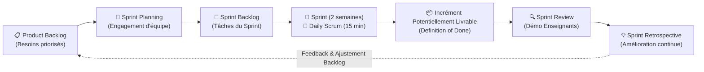

---

### 2.2 Rôles, Artefacts et Cérémonies Scrum

#### A. Les Rôles Scrum (Actors)
- **Product Owner (PO)** :
  - Porte la vision fonctionnelle globale de la plateforme.
  - Rédige les récits utilisateurs (*User Stories*) avec leurs critères d'acceptation.
  - Priorise continuellement le *Product Backlog* pour maximiser la valeur délivrée aux étudiants et aux professeurs de l'EMSI.
- **Scrum Master (SM)** :
  - Veille au respect rigoureux des principes et valeurs Scrum.
  - Facilite les cérémonies agiles et régule les échanges.
  - Identifie et élimine les points de blocage organisationnels et techniques rencontrés par l'équipe.
- **Équipe de Développement (DEV Team)** :
  - Équipe pluridisciplinaire responsable de la conception, de l'implémentation, des tests et du déploiement des microservices et des interfaces utilisateurs.
  - Auto-organisée, elle estime la complexité des tâches (via le Planning Poker en Story Points) et s'engage sur l'incrément de chaque sprint.

#### B. Les Artefacts Scrum
- **Product Backlog** : Liste vivante et ordonnée de toutes les exigences, fonctionnalités et améliorations techniques prévues pour la plateforme.
- **Sprint Backlog** : Sous-ensemble d'items du Product Backlog sélectionnés pour un sprint donné, complété par le plan d'action technique pour les réaliser.
- **Incrément de Produit** : Version fonctionnelle, testée et documentée du produit, respectant la *Definition of Done (DoD)* (code revu, tests unitaires passants, conteneurisation Docker valide).

#### C. Les Cérémonies Scrum
- **Sprint Planning (Planification de Sprint)** : Réunion de cadrage en début d'itération (durée 2h pour un sprint de 2 semaines) où l'équipe définit l'objectif du sprint (*Sprint Goal*) et sélectionne les User Stories.
- **Daily Scrum (Mêlée Quotidienne)** : Point debout de 15 minutes chaque jour axé sur 3 questions : *Qu'ai-je accompli hier ? Que vais-je accomplir aujourd'hui ? Quels sont les obstacles rencontrés ?*
- **Sprint Review (Revue de Sprint)** : Session de démonstration de l'incrément opérationnel en fin de sprint auprès des parties prenantes (encadrants académiques).
- **Sprint Retrospective (Rétrospective de Sprint)** : Séance d'inspection interne de l'équipe pour capitaliser sur les succès, identifier les axes d'amélioration et définir des actions concrètes pour le sprint suivant.

---

### 2.3 Signification de « A1 - 2 Agilité »

Dans les documents de cadrage et grilles d'évaluation académiques, la mention **« A1 - 2 Agilité »** correspond à une progression mesurée de la maturité agile :
- **Niveau A1 (Fondations Agiles)** : Mise en place des bases méthodologiques (découpage en sprints courts de 2 semaines, tenue des cérémonies Scrum, rédaction de User Stories basiques, gestion d'un Kanban simple).
- **Niveau A2 (Agilité Avancée & Automatisation Continue)** : Maturation de l'agilité vers l'ingénierie DevOps moderne. Cela englobe :
  - L'intégration d'automatisations intelligentes (calcul de compatibilité algorithmique, recommandations de compétences).
  - L'intégration continue (CI/CD) avec tests automatisés à chaque Pull Request sur le Monorepo.
  - Le suivi quantitatif de la vélocité d'équipe et des flux de travail (Burndown charts et limitation du WIP).

---

### 2.4 Analyse Comparative : Scrum vs Kanban & Choix de Scrumban

| Dimension | Scrum Pur | Kanban Pur | **Notre Choix : Scrumban (Hybride)** |
| :--- | :--- | :--- | :--- |
| **Cadence temporelle** | Itérations fermées (Sprints de 2 semaines) | Flux continu sans itérations prédéfinies | **Cadence par Sprints de 2 semaines pour les jalons académiques** |
| **Gestion du travail en cours (WIP)** | Fixée au Sprint Planning par engagement | Limitée strictement par colonne de statut (WIP Limits) | **WIP limits visuelles sur le tableau Kanban pendant le sprint** |
| **Rôles & Responsabilités** | Rôles stricts (PO, SM, Dev) | Pas de rôles prescrits | **Rôles Scrum formels (PO, SM, Développeurs)** |
| **Ajustement des priorités** | Périmètre verrouillé durant le sprint | Modification dynamique à tout moment | **Scope de Sprint stable + flexibilité sur les correctifs critiques** |
| **Indicateurs de pilotage** | Vélocité & Burndown Chart | Lead Time & Cycle Time | **Suivi mixte : Vélocité du sprint + Cycle Time des microservices** |

> [!NOTE]  
> **Justification du choix de Scrumban :**  
> L'environnement académique d'une école d'ingénieurs comme l'EMSI impose des échéances temporelles incompressibles (dates de jalons, revues avec les encadrants, périodes de soutenance). **Scrum** fournit le cadre cadencé indispensable pour ces rendez-vous pédagogiques. Parallèlement, l'approche **Kanban** apporte la souplesse opérationnelle nécessaire au quotidien pour gérer les flux asynchrones des trois pôles techniques (Frontend React, Backend Microservices, DevOps/Docker).

---

## 3. Planning Prévisionnel & Diagramme de Gantt

### 3.1 Découpage des Sprints et Jalons

Le cycle de vie du projet est découpé en **6 phases itératives** réparties sur le semestre universitaire :

- **Sprint 0 (Semaines 1-2) : Cadrage & Socle Architectural**
  - Analyse de l'existant, benchmarking et spécification des besoins.
  - Conception de l'architecture microservices (DDD) et initialisation du Monorepo Git.
  - Configuration de l'environnement Docker multi-bases PostgreSQL (`auth_db`, `project_db`, `team_matching_db`).
- **Sprint 1 (Semaines 3-4) : Sécurité, JWT & Profilage de Compétences**
  - Développement de l'`auth-service` (Spring Security 6, JJWT, BCrypt).
  - Gestion du référentiel des compétences et déclaration individuelle (niveaux 1 à 5).
  - Frontend : Page de connexion avec branding vert EMSI (`#15885a`), `AuthContext`, Radar Chart de compétences.
- **Sprint 2 (Semaines 5-6) : Gestion des Sujets, CDC PDF & Jalons Checkbox**
  - Développement du `project-service` (cycle de vie des sujets, quotas d'équipe).
  - Module de téléversement et consultation du fichier PDF officiel du cahier des charges.
  - Création des jalons de projet et composant de Roadmap avec cases à cocher (Checkboxes).
- **Sprint 3 (Semaines 7-8) : Moteur de Matching Algorithmique & Groupes Étudiants**
  - Implémentation du `SkillMatchingEngine` dans `team-matching-service`.
  - Calcul matriciel du score global pondéré ($w_i$), gestion des critères de veto bloquants.
  - Génération du flux personnalisé de recommandations PFE pour les étudiants.
  - Ajout et gestion directe des membres de groupe depuis le Dashboard Étudiant.
- **Sprint 4 (Semaines 9-10) : Communication Temps Réel & Visioconférence Google Meet**
  - Mise en place du broker WebSocket STOMP (`chat-service`).
  - Chatroom de projet partagée accessible en 1 clic via l'icône sur chaque carte projet.
  - Module de messagerie privée 1-à-1 entre utilisateurs.
  - Planificateur de réunions à date convenue avec génération de lien Google Meet.
- **Sprint 5 (Semaines 11-12) : Intégration Continue, Recette Globale & Soutenance**
  - Déploiement des microservices via Docker Compose et API Gateway.
  - Tests d'intégration de bout en bout, tests de charge et audit de sécurité.
  - Rédaction du rapport de projet et préparation de la soutenance finale.

---

### 3.2 Diagramme de Gantt du Projet

Voici la restitution graphique du planning prévisionnel sous forme de diagramme de Gantt avec mise en évidence des dépendances et jalons :

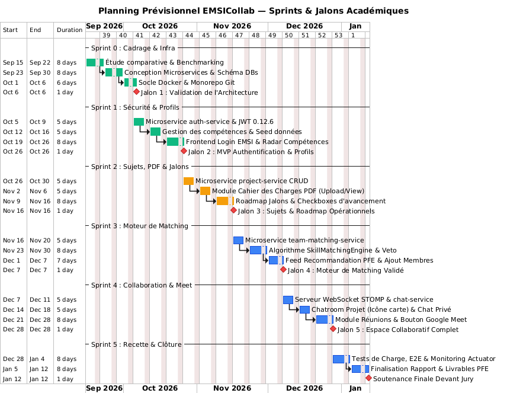

```mermaid
gantt
    dateFormat  YYYY-MM-DD
    title Planning Prévisionnel EMSICollab — Sprints & Jalons Académiques
    excludes    weekends

    section Sprint 0 : Cadrage & Infra
    Étude comparative & Benchmarking            :done, s0_1, 2026-09-15, 6d
    Conception Microservices & Schéma DBs      :done, s0_2, after s0_1, 6d
    Socle Docker & Monorepo Git                 :done, s0_3, after s0_2, 4d
    Jalon 1 : Validation de l'Architecture      :milestone, m1, after s0_3, 0d

    section Sprint 1 : Sécurité & Profils
    Microservice auth-service & JWT 0.12.6      :done, s1_1, 2026-10-05, 5d
    Gestion des compétences & Seed données      :done, s1_2, after s1_1, 5d
    Frontend Login EMSI & Radar Compétences    :done, s1_3, after s1_2, 6d
    Jalon 2 : MVP Authentification & Profils    :milestone, m2, after s1_3, 0d

    section Sprint 2 : Sujets, PDF & Jalons
    Microservice project-service CRUD           :active, s2_1, 2026-10-25, 5d
    Module Cahier des Charges PDF (Upload/View) :active, s2_2, after s2_1, 5d
    Roadmap Jalons & Checkboxes d'avancement    :active, s2_3, after s2_2, 6d
    Jalon 3 : Sujets & Roadmap Opérationnels    :milestone, m3, after s2_3, 0d

    section Sprint 3 : Moteur de Matching
    Microservice team-matching-service          :s3_1, 2026-11-16, 5d
    Algorithme SkillMatchingEngine & Veto       :s3_2, after s3_1, 6d
    Feed Recommandation PFE & Ajout Membres     :s3_3, after s3_2, 5d
    Jalon 4 : Moteur de Matching Validé         :milestone, m4, after s3_3, 0d

    section Sprint 4 : Collaboration & Meet
    Serveur WebSocket STOMP & chat-service      :s4_1, 2026-12-07, 5d
    Chatroom Projet (Icône carte) & Chat Privé :s4_2, after s4_1, 5d
    Module Réunions & Bouton Google Meet       :s4_3, after s4_2, 6d
    Jalon 5 : Espace Collaboratif Complet       :milestone, m5, after s4_3, 0d

    section Sprint 5 : Recette & Clôture
    Tests de Charge, E2E & Monitoring Actuator :s5_1, 2026-12-28, 6d
    Finalisation Rapport & Livrables PFE        :s5_2, after s5_1, 6d
    Soutenance Finale Devant Jury               :milestone, m6, after s5_2, 0d
```

---

# II) Analyse et Conception du Projet (Modélisation UML)

## 1. Diagramme des Cas d'Utilisation (Use Case Diagram)

### 1.1 Identification des Acteurs

- **🎓 Étudiant (STUDENT)** : Utilisateur principal en formation d'ingénierie. Il déclare ses aptitudes techniques, consulte son flux de recommandations PFE personnalisées, forme ou intègre une équipe, postule aux sujets, valide l'avancement par jalons (checkboxes), échange en chat privé ou en chatroom de projet et participe aux visioconférences Google Meet.
- **👨‍🏫 Professeur Encadrant (PROFESSOR)** : Responsable académique. Il rédige les sujets, dépose le document officiel du cahier des charges (PDF), configure les exigences pondérées et critères veto, évalue les candidatures ordonnées par score algorithmique, anime la chatroom de projet et programme les réunions Google Meet.
- **🛡️ Administrateur (ADMIN)** : Superviseur de la plateforme. Il administre les comptes utilisateurs, importe les cohortes d'étudiants par CSV, gère le référentiel des compétences (taxonomie) et contrôle l'état de santé des microservices.
- **⚙️ Moteur Algorithmique (Système)** : Acteur secondaire automatisé exécutant le calcul des scores d'adéquation pondérée, l'évaluation des règles de veto et le tri des recommandations PFE.

---

### 1.2 Diagramme Global Synthétique des Cas d'Utilisation

Voici la représentation globale synthétique du système :

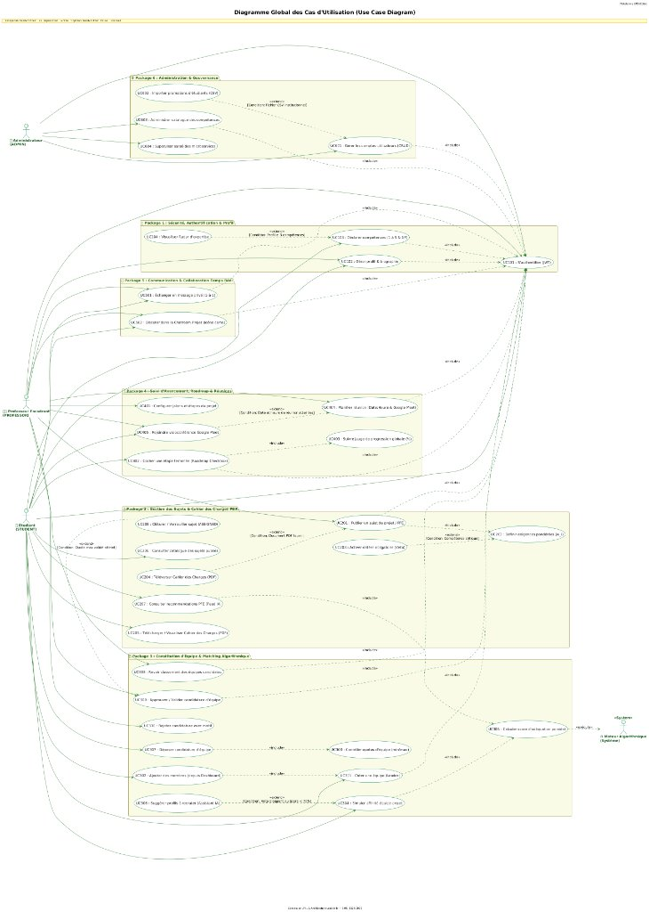

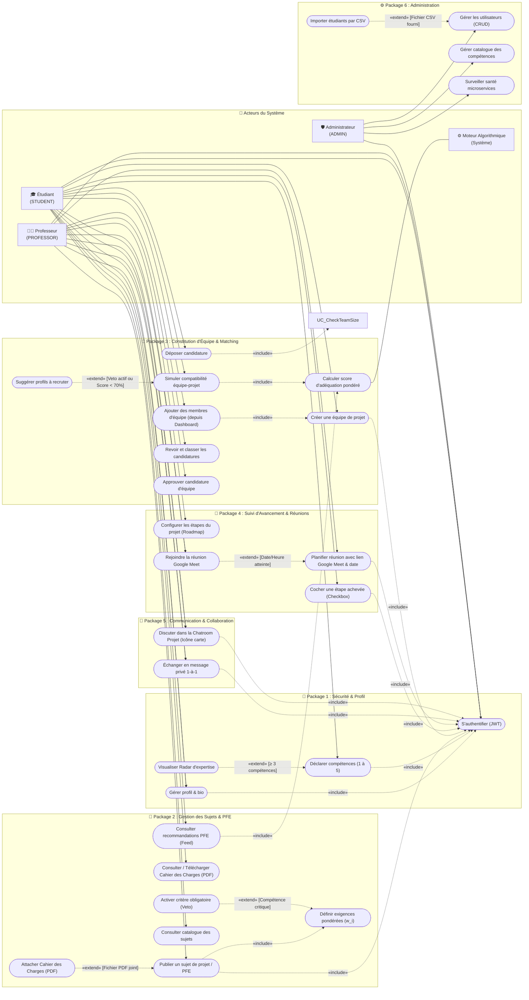

---

### 1.3 Décomposition Modulaire des Cas d'Utilisation (Diagrammes Détaillés par Package)

Afin d'offrir une lisibilité optimale dans les rapports de conception, le diagramme global ci-dessus est scindé en **6 sous-diagrammes modulaires ciblés**.

#### 1.3.1 Module 1 : Sécurité, Authentification & Profils
📁 Fichier source : [`docs/diagrams/sub_diagrams/uc_pkg1_security.puml`](diagrams/sub_diagrams/uc_pkg1_security.puml)

Ce module centralise la connexion par JWT et la déclaration fine des compétences techniques de chaque élève ingénieur.

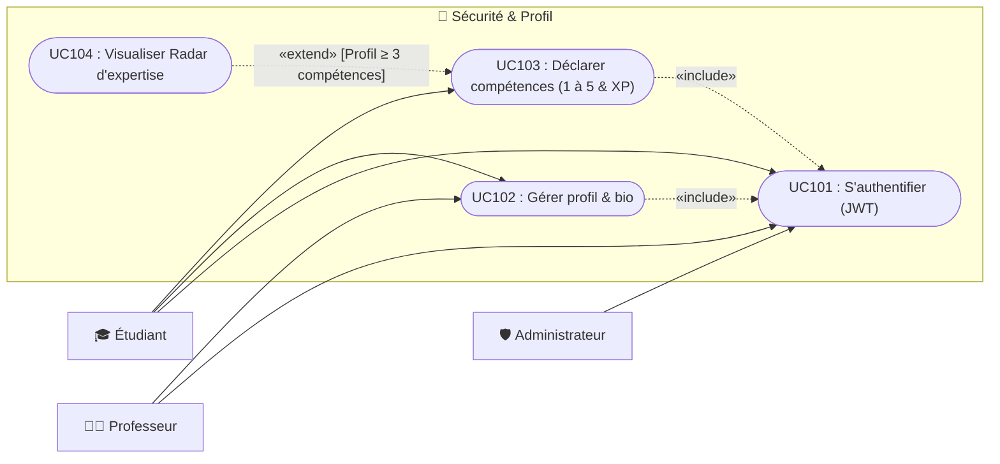

#### 1.3.2 Module 2 : Gestion des Sujets & Cahier des Charges PDF
📁 Fichier source : [`docs/diagrams/sub_diagrams/uc_pkg2_projects_pdf.puml`](diagrams/sub_diagrams/uc_pkg2_projects_pdf.puml)

Ce module permet à l'enseignant de publier ses sujets, d'attacher le document PDF officiel du cahier des charges et de formaliser les exigences pondérées et vetos bloquants.

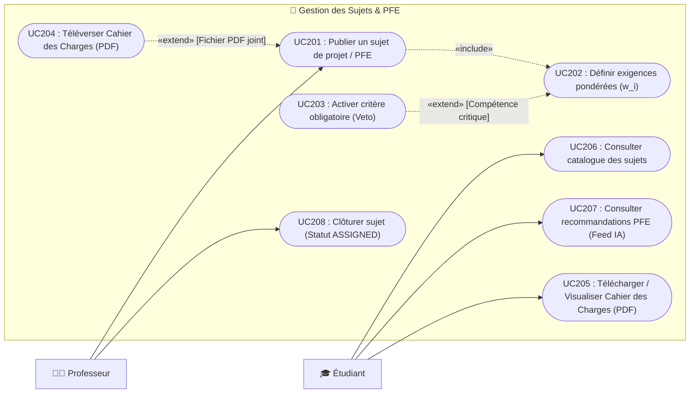

#### 1.3.3 Module 3 : Constitution d'Équipe & Moteur de Matching Algorithmique
📁 Fichier source : [`docs/diagrams/sub_diagrams/uc_pkg3_teams_matching.puml`](diagrams/sub_diagrams/uc_pkg3_teams_matching.puml)

Ce module régit la formation d'équipes depuis le dashboard, l'exécution du `SkillMatchingEngine`, la détection de veto et la validation des candidatures.

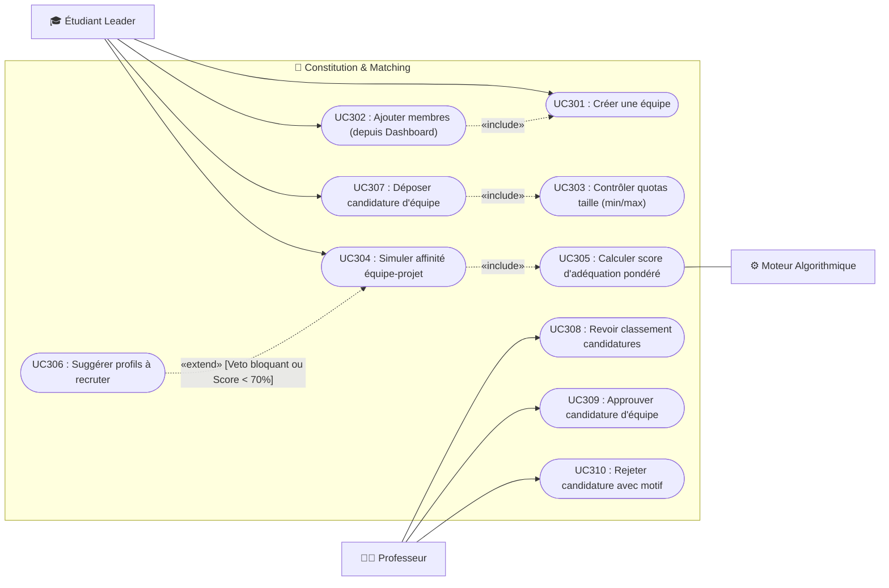

#### 1.3.4 Module 4 : Suivi d'Avancement, Roadmap Checkboxes & Réunions Meet
📁 Fichier source : [`docs/diagrams/sub_diagrams/uc_pkg4_milestones_meetings.puml`](diagrams/sub_diagrams/uc_pkg4_milestones_meetings.puml)

Ce module matérialise le suivi de projet par étapes à cocher (checkboxes) avec mise à jour en direct de la jauge de progression, et la planification de rendez-vous Google Meet à date convenue.

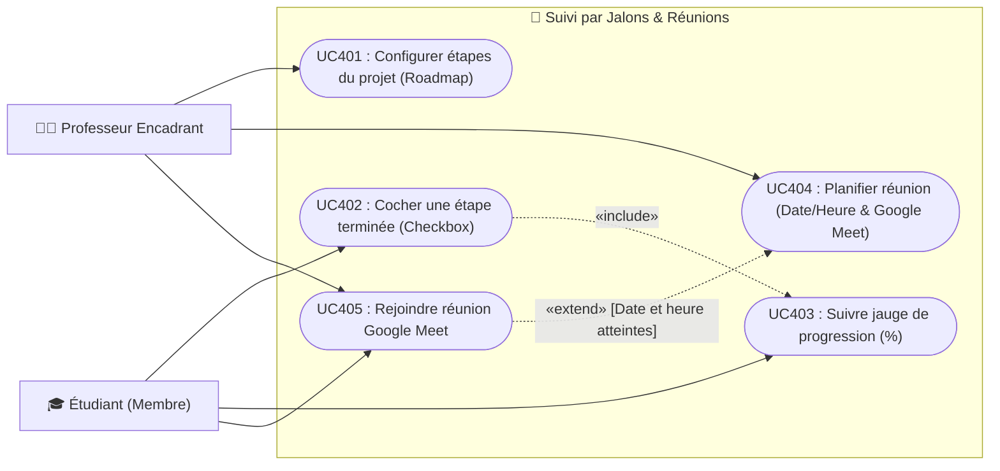

#### 1.3.5 Module 5 : Communication & Collaboration Temps Réel
📁 Fichier source : [`docs/diagrams/sub_diagrams/uc_pkg5_communication.puml`](diagrams/sub_diagrams/uc_pkg5_communication.puml)

Ce module fournit les deux canaux de discussion intégrés : la messagerie privée 1-à-1 et la chatroom de projet accessible en 1 clic via l'icône de chaque carte projet.

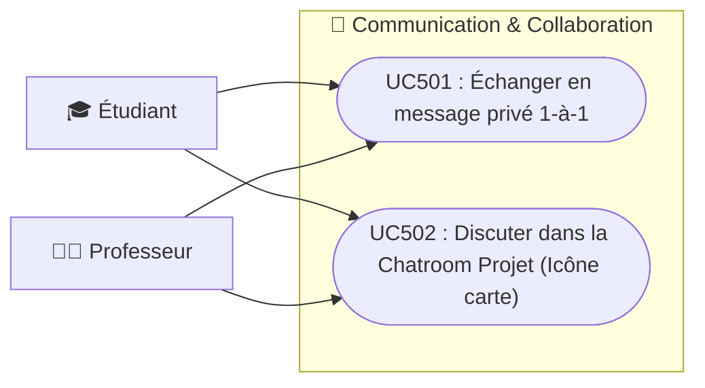

#### 1.3.6 Module 6 : Administration & Gouvernance Système
📁 Fichier source : [`docs/diagrams/sub_diagrams/uc_pkg6_administration.puml`](diagrams/sub_diagrams/uc_pkg6_administration.puml)

Ce module permet la gouvernance globale de la plateforme, l'import en masse des étudiants et le monitoring de la santé des microservices.

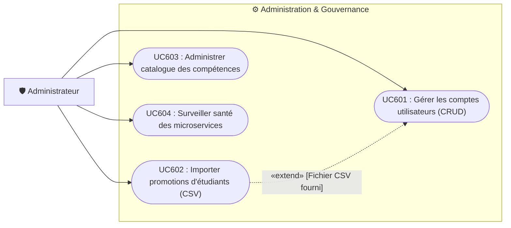

---

### 1.4 Description Détaillée des Cas d'Utilisation Majeurs

#### UC01 : Calcul du Score d'Adéquation & Détection de Veto (`UC_CalcScore`)
- **Acteur primaire** : Moteur Algorithmique (déclenché par Étudiant ou Professeur).
- **Préconditions** : L'équipe est constituée d'au moins un membre et le projet comporte des exigences techniques.
- **Scénario nominal** :
  1. Le système récupère le niveau maximum de l'équipe pour chaque compétence : $L_{team}(s) = \max_{m} (\text{Niveau}(m, s))$.
  2. Le système vérifie les critères obligatoires (`isMandatory == true`). Si tous sont satisfaits ($L_{team} \ge L_{req}$), il calcule le ratio de satisfaction : $\text{Ratio}(s_i) = \min(1.0, L_{team}(s_i) / L_{req}(s_i))$.
  3. Le système pondère les ratios par les poids $w_i$ pour générer un score global en pourcentage (0 à 100%).
  4. L'équipe est classée : `EXCELLENT` ($\ge 85\%$), `GOOD` ($\ge 70\%$) ou `MODERATE` ($\ge 50\%$).
- **Scénario alternatif (Déclenchement du Veto)** :
  - Si une compétence obligatoire $s_{crit}$ présente $L_{team}(s_{crit}) < L_{req}(s_{crit})$, le système assigne le statut `BLOCKED_MANDATORY_MISSING`, bloque la soumission et active le cas d'utilisation d'aide au recrutement (`UC_RecruitHelp`).

#### UC02 : Validation d'un Jalon de Projet par Checkbox (`UC_CheckMilestones`)
- **Acteur primaire** : Étudiant membre de l'équipe affectée.
- **Préconditions** : L'étudiant est authentifié et fait partie d'une équipe dont le statut est `APPROVED` sur le projet.
- **Scénario nominal** :
  1. L'étudiant consulte la roadmap du projet dans son dashboard.
  2. Il clique sur la case à cocher d'une étape terminée (ex: *Étape 3 : Développement Backend APIs*).
  3. Le frontend envoie une requête réactive `PATCH /api/v1/projects/{id}/milestones/{milestoneId}/toggle`.
  4. Le backend enregistre l'état `is_completed = true`, l'auteur du cochage (`completed_by = X-User-Id`) et l'horodatage (`completed_at`).
  5. Le système recalcule le pourcentage de progression globale ($\frac{\text{nb étapes complétées}}{\text{nb total d'étapes}} \times 100$) et le diffuse en WebSocket à tous les membres et au professeur.

#### UC03 : Planification d'une Réunion Google Meet (`UC_ScheduleMeet`)
- **Acteur primaire** : Professeur Encadrant.
- **Scénario nominal** :
  1. Le professeur sélectionne le projet et l'équipe concernée.
  2. Il renseigne le titre, l'ordre du jour, fixe la date et l'heure précises (ex: *Mardi 24 Novembre 2026 à 15h30*).
  3. Il saisit ou génère le lien officiel de visioconférence Google Meet (`https://meet.google.com/xxx-yyyy-zzz`).
  4. Le système persiste la réunion et met à jour l'agenda partagé sur le dashboard de l'étudiant.
  5. À la date convenue, un bouton direct **« Rejoindre sur Google Meet »** redirige les participants en 1 clic.

---

## 2. Diagrammes de Séquence Système (Sequence Diagrams)

### 2.1 Scénario 1 : Authentification, Profilage & Radar de Compétences

Ce scénario modélise la connexion sécurisée d'un élève ingénieur, la récupération de son identité via token JWT et la restitution de sa matrice de compétences sous forme de Radar Chart.

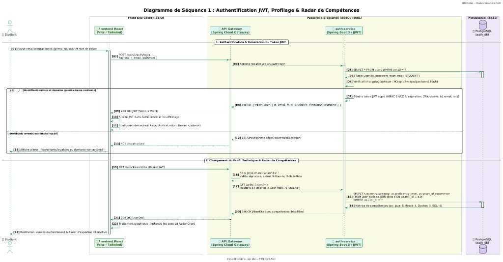

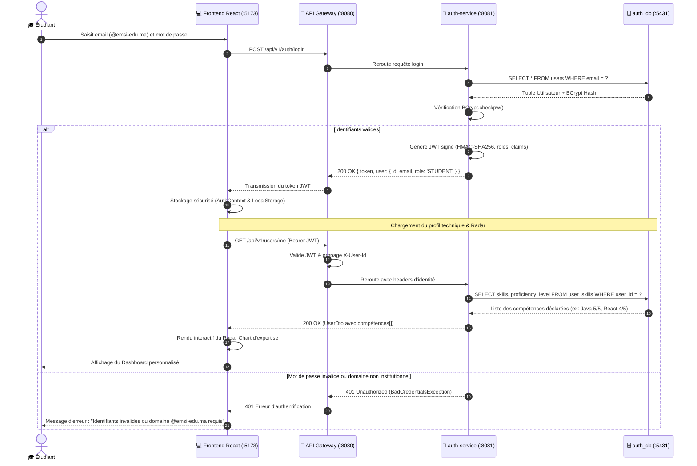

---

### 2.2 Scénario 2 : Publication de Sujet avec Exigences Pondérées & Cahier des Charges PDF

Ce scénario illustre la création par un enseignant d'un sujet PFE intégrant le téléversement du cahier des charges officiel en PDF et l'émission d'un événement asynchrone Kafka.

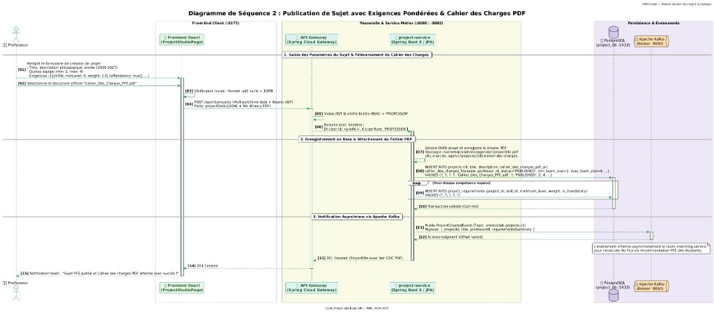

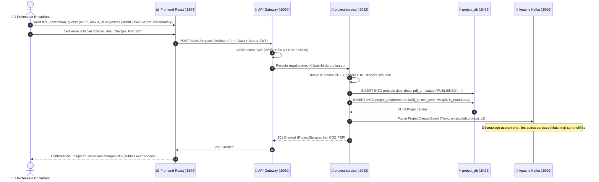

---

### 2.3 Scénario 3 : Constitution d'Équipe & Simulation de Matching avec Règle de Veto

Ce scénario met en jeu l'ajout d'un équipier depuis le dashboard étudiant et le calcul algorithmique d'adéquation avec gestion de la règle de veto.

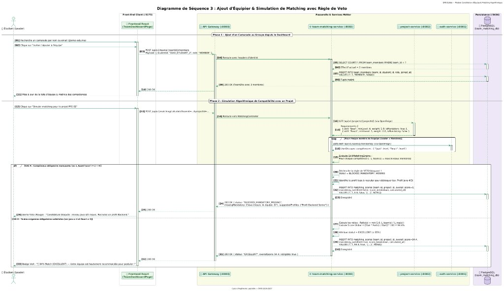

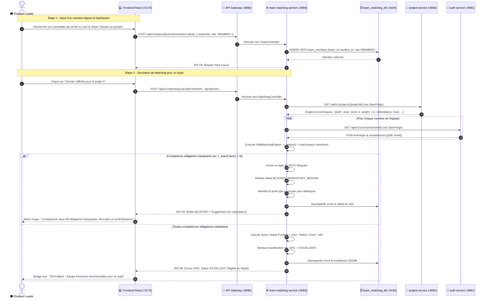

---

### 2.4 Scénario 4 : Collaboration en Chatroom de Projet (Icône Carte Projet)

Ce scénario détaille la connexion WebSocket STOMP initiée en un clic sur l'icône de carte projet et l'échange temps réel entre le professeur et l'équipe étudiante.

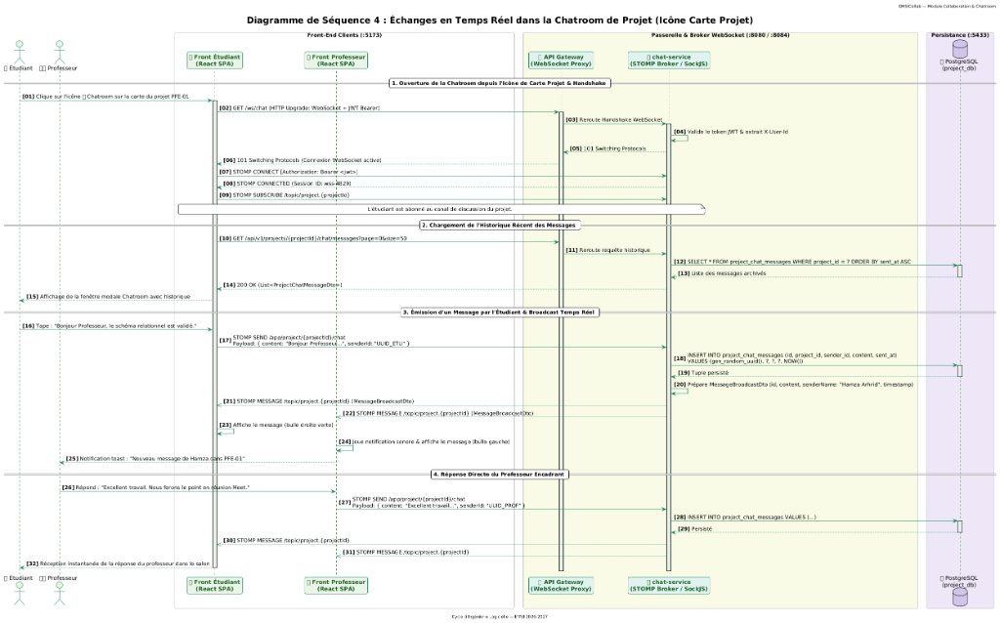

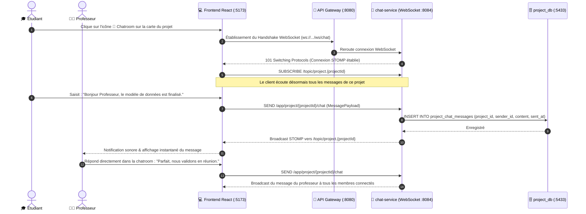

---

### 2.5 Scénario 5 : Suivi d'Avancement par Cases à Cocher (Roadmap Checkboxes)

Ce scénario illustre la validation d'une étape de projet via case à cocher, l'enregistrement de l'audit et la mise à jour dynamique de la progression.

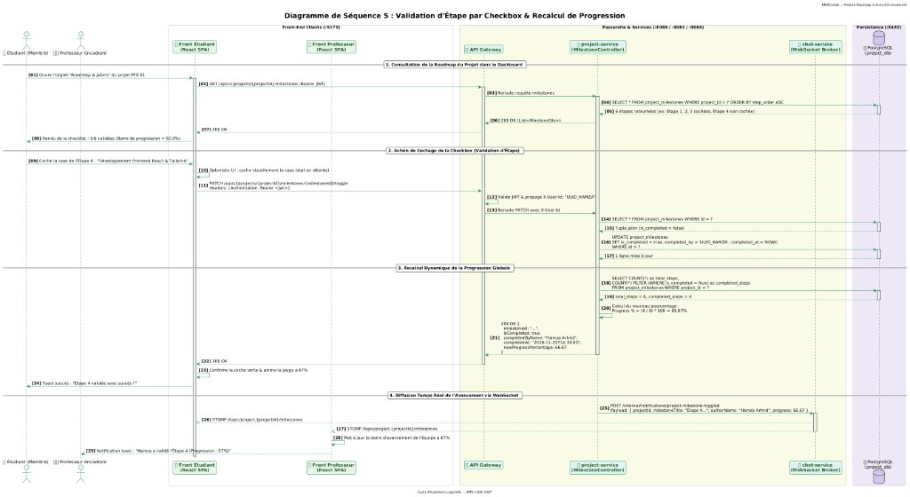

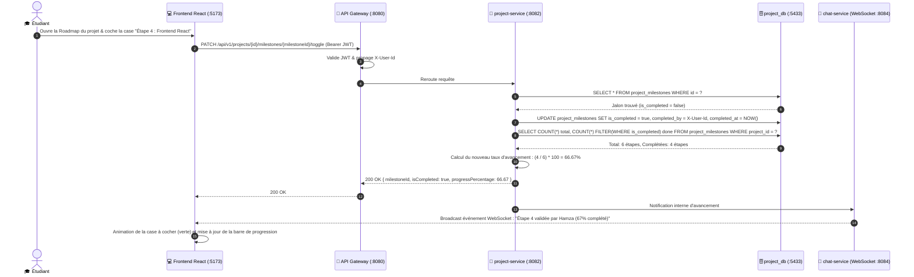

---

### 2.6 Scénario 6 : Planification & Visioconférence Google Meet

Ce scénario décrit la programmation d'une soutenance intermédiaire à date fixe par le professeur et la connexion directe des participants sur Google Meet.

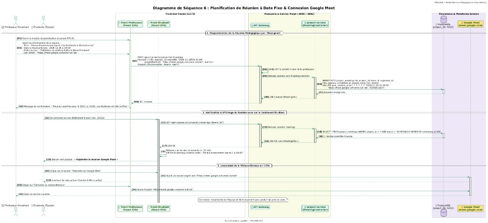

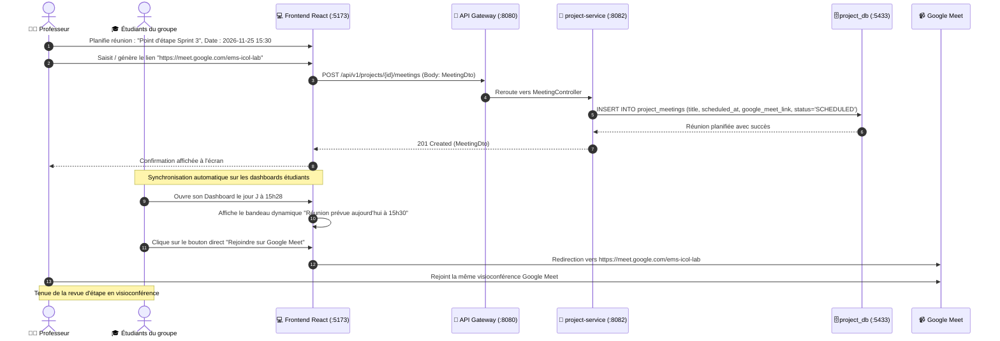

---

## 3. Diagramme de Classes du Domaine (Class Diagram)

### 3.1 Vue Statique Globale du Domaine Métier

Voici la vue d'ensemble du diagramme de classes montrant l'intégration entre les quatre contextes délimités (*Bounded Contexts*) :

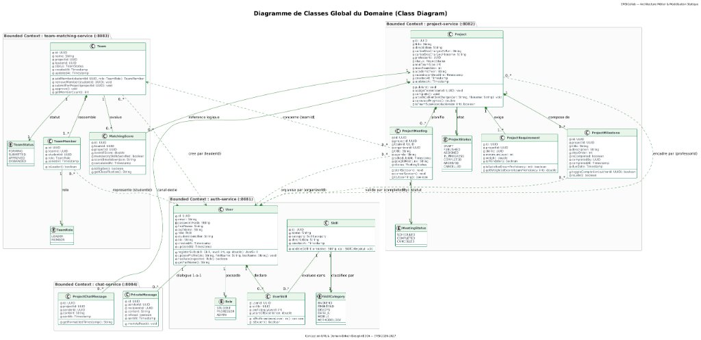

```mermaid
classDiagram
    %% Bounded Context : Authentification & Compétences (auth-service)
    class User {
        +UUID id
        +String email
        +String passwordHash
        +String firstName
        +String lastName
        +Role role
        +String studentIdentifier
        +String bio
        +Timestamp createdAt
        +Timestamp updatedAt
        +registerSkill(Skill skill, int level, double xp)
        +updateBio(String newBio)
        +hasRole(Role expectedRole) boolean
    }

    class Role {
        <<enumeration>>
        STUDENT
        PROFESSOR
        ADMIN
    }

    class Skill {
        +UUID id
        +String name
        +SkillCategory category
        +String description
        +Timestamp createdAt
    }

    class SkillCategory {
        <<enumeration>>
        BACKEND
        FRONTEND
        DEVOPS
        DATA_AI
        MOBILE
        METHODOLOGY
    }

    class UserSkill {
        +UUID userId
        +UUID skillId
        +int proficiencyLevel
        +double yearsOfExperience
        +isExpert() boolean
    }

    %% Bounded Context : Projets & Cadrage (project-service)
    class Project {
        +UUID id
        +String title
        +String description
        +String cahierDesChargesPdfUrl
        +String cahierDesChargesFilename
        +UUID professorId
        +ProjectStatus status
        +int minTeamSize
        +maxTeamSize
        +String academicYear
        +Timestamp submissionDeadline
        +Timestamp createdAt
        +publish()
        +assignTeam(UUID teamId)
        +calculateProgress() double
    }

    class ProjectStatus {
        <<enumeration>>
        DRAFT
        PUBLISHED
        ASSIGNED
        IN_PROGRESS
        COMPLETED
        ARCHIVED
        CANCELLED
    }

    class ProjectRequirement {
        +UUID id
        +UUID projectId
        +UUID skillId
        +int minimumLevel
        +double weight
        +boolean isMandatory
        +isSatisfiedBy(int teamLevel) boolean
    }

    class ProjectMilestone {
        +UUID id
        +UUID projectId
        +String title
        +String description
        +int stepOrder
        +boolean isCompleted
        +UUID completedBy
        +Timestamp completedAt
        +Timestamp dueDate
        +toggleCompletion(UUID userId) boolean
    }

    class ProjectMeeting {
        +UUID id
        +UUID projectId
        +UUID teamId
        +UUID organizerId
        +String title
        +String agenda
        +Timestamp scheduledAt
        +String googleMeetLink
        +MeetingStatus status
        +startMeeting()
        +cancelMeeting()
    }

    class MeetingStatus {
        <<enumeration>>
        SCHEDULED
        COMPLETED
        CANCELLED
    }

    %% Bounded Context : Équipes & Matching (team-matching-service)
    class Team {
        +UUID id
        +String name
        +UUID projectId
        +UUID leaderId
        +TeamStatus status
        +Timestamp createdAt
        +addMember(UUID studentId, TeamRole role)
        +removeMember(UUID studentId)
        +canSubmit(int minSize, int maxSize) boolean
    }

    class TeamStatus {
        <<enumeration>>
        FORMING
        SUBMITTED
        APPROVED
        DISBANDED
    }

    class TeamRole {
        <<enumeration>>
        LEADER
        MEMBER
    }

    class TeamMember {
        +UUID id
        +UUID teamId
        +UUID studentId
        +TeamRole role
        +Timestamp joinedAt
    }

    class MatchingScore {
        +UUID id
        +UUID teamId
        +UUID projectId
        +double overallScore
        +boolean mandatorySkillsSatisfied
        +String scoreBreakdownJson
        +Timestamp calculatedAt
        +isEligible() boolean
        +getClassification() String
    }

    %% Bounded Context : Collaboration & Chat (chat-service)
    class PrivateMessage {
        +UUID id
        +UUID senderId
        +UUID recipientId
        +String content
        +boolean isRead
        +Timestamp sentAt
        +markAsRead()
    }

    class ProjectChatMessage {
        +UUID id
        +UUID projectId
        +UUID senderId
        +String content
        +Timestamp sentAt
    }

    %% Associations & Relations
    User "1" --> "1" Role : possede
    Skill "1" --> "1" SkillCategory : classifiee par
    User "1" *-- "0..*" UserSkill : declare
    Skill "1" -- "0..*" UserSkill : evaluee dans

    Project "1" --> "1" ProjectStatus : suit
    Project "1" *-- "1..*" ProjectRequirement : exige
    Project "1" *-- "0..*" ProjectMilestone : decoupe en
    Project "1" *-- "0..*" ProjectMeeting : organise
    ProjectMeeting "1" --> "1" MeetingStatus : statut

    Team "1" --> "1" TeamStatus : statut
    Team "1" *-- "1..*" TeamMember : est composee de
    TeamMember "1" --> "1" TeamRole : occupe
    Team "1" -- "0..*" MatchingScore : evaluee par
    Project "1" -- "0..*" MatchingScore : concerne

    Project "1" *-- "0..*" ProjectChatMessage : centralise
    User "1" -- "0..*" PrivateMessage : emet / recoit
```

---

### 3.2 Décomposition Modulaire du Diagramme de Classes par Microservice (Bounded Context)

Afin d'offrir une lecture claire, détaillée et parfaitement lisible, le modèle de données est découpé par **Bounded Context** (Database-per-Service).

#### 3.2.1 Service d'Authentification & Compétences (`auth-service`)
📁 Fichier source : [`docs/diagrams/sub_diagrams/class_auth_service.puml`](diagrams/sub_diagrams/class_auth_service.puml)

Ce modèle régit l'identité des utilisateurs, les accréditations RBAC et le profilage fin des compétences techniques.

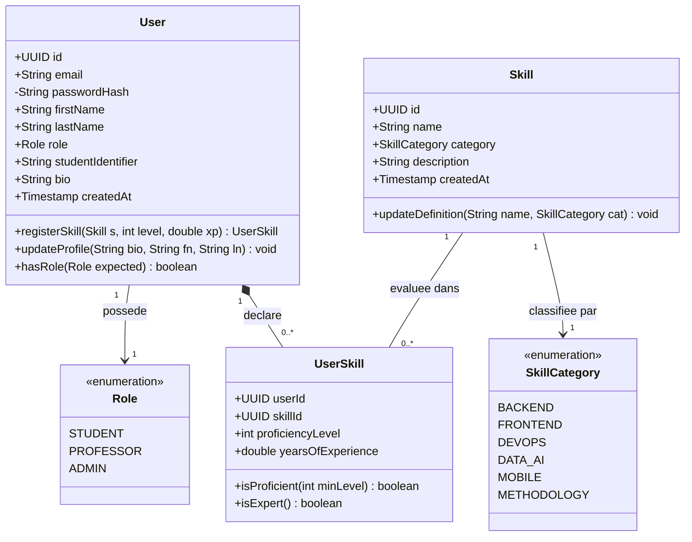

#### 3.2.2 Service de Gestion des Projets, CDC PDF & Jalons (`project-service`)
📁 Fichier source : [`docs/diagrams/sub_diagrams/class_project_service.puml`](diagrams/sub_diagrams/class_project_service.puml)

Ce modèle englobe le cycle de vie du sujet, le document officiel du cahier des charges PDF, la roadmap à étapes interactives (checkboxes) et le calendrier des réunions Google Meet.

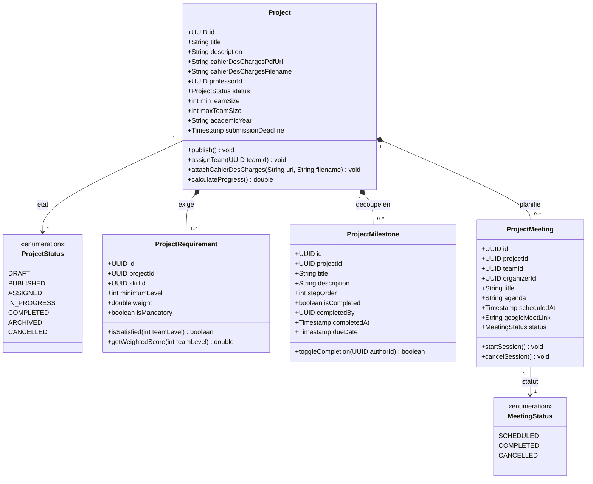

#### 3.2.3 Service d'Équipes & Matching Algorithmique (`team-matching-service`)
📁 Fichier source : [`docs/diagrams/sub_diagrams/class_team_matching_service.puml`](diagrams/sub_diagrams/class_team_matching_service.puml)

Ce modèle gère la constitution des groupes d'étudiants depuis le dashboard et l'évaluation mathématique de leur compatibilité face aux exigences des projets.

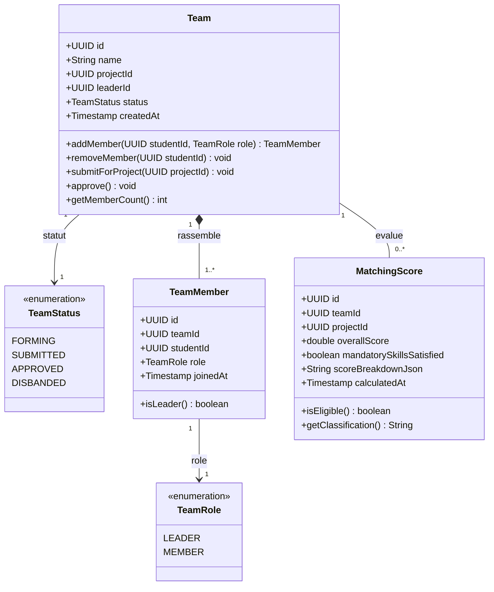

#### 3.2.4 Service de Collaboration & Messagerie Temps Réel (`chat-service`)
📁 Fichier source : [`docs/diagrams/sub_diagrams/class_chat_service.puml`](diagrams/sub_diagrams/class_chat_service.puml)

Ce modèle assure la persistance des conversations privées 1-à-1 et des messages échangés au sein des salons de discussion de chaque projet.

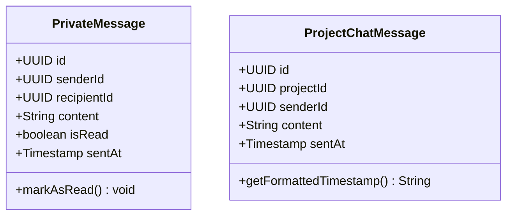

---

### 3.3 Dictionnaire des Classes et Responsabilités

| Classe Métier | Bounded Context | Responsabilité Principale |
| :--- | :--- | :--- |
| **`User`** | `auth-service` | Représente tout acteur du système (Étudiant, Professeur, Admin) avec ses accréditations, son identifiant institutionnel et sa biographie. |
| **`Skill`** | `auth-service` | Compétence technique normalisée (ex: *Spring Boot*, *React*, *PostgreSQL*, *Docker*) rattachée à un domaine d'ingénierie. |
| **`UserSkill`** | `auth-service` | Entité associative qualifiant le niveau d'expertise (1 à 5) et l'expérience d'un étudiant sur une compétence donnée. |
| **`Project`** | `project-service` | Sujet PFE ou projet d'ingénierie publié par un enseignant avec ses contraintes d'effectif, son statut et son **fichier PDF de cahier des charges**. |
| **`ProjectRequirement`** | `project-service` | Exigence technique attendue sur un projet, caractérisée par un niveau minimum, un poids $w_i$ et l'indicateur de veto `isMandatory`. |
| **`ProjectMilestone`** | `project-service` | Étape ordonnée du projet servant de jalon à cocher (**checkbox**) ; conserve l'auteur du cochage et l'horodatage pour le calcul de progression. |
| **`ProjectMeeting`** | `project-service` | Rendez-vous de suivi ou de soutenance planifié avec **date/heure précises** et **lien direct Google Meet**. |
| **`Team`** | `team-matching-service` | Groupe d'étudiants constitué depuis le dashboard pour candidater et réaliser un projet académique. |
| **`TeamMember`** | `team-matching-service` | Appartenance d'un étudiant à une équipe avec spécification de son rôle (`LEADER` ou `MEMBER`). |
| **`MatchingScore`** | `team-matching-service` | Résultat de l'évaluation algorithmique d'une équipe face à un projet : score global en %, conformité aux vetos et décomposition par compétence. |
| **`ProjectChatMessage`**| `chat-service` | Message diffusé en temps réel (WebSocket STOMP) dans la chatroom du projet accessible depuis la carte projet. |
| **`PrivateMessage`** | `chat-service` | Message textuel instantané et confidentiel échangé en 1-à-1 entre deux utilisateurs de la plateforme. |

---

> 📌 **Document de référence pour le projet EMSICollab.**  
> *Rédigé dans le respect des normes d'ingénierie logicielle et des exigences académiques de l'École Marocaine des Sciences de l'Ingénieur (EMSI).*
